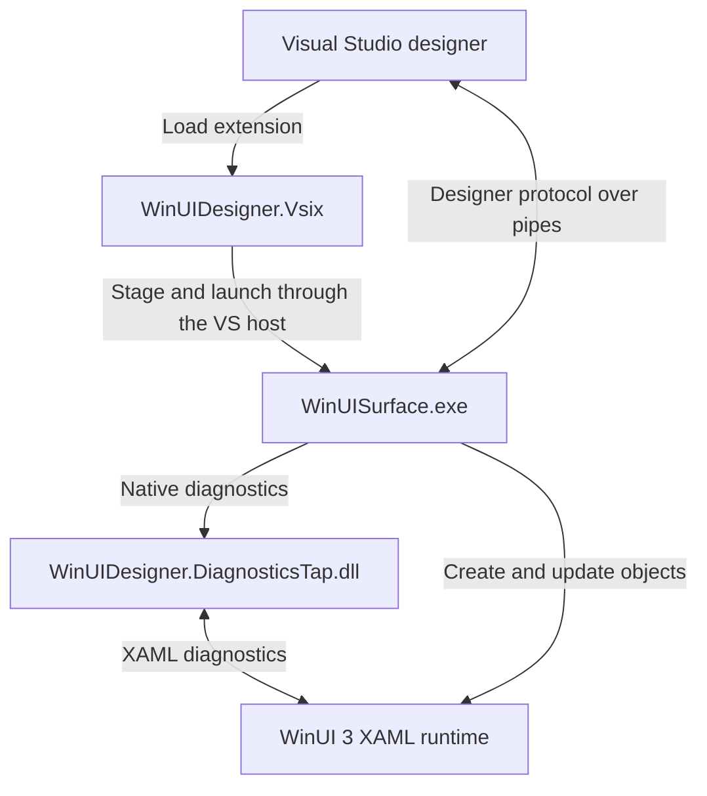

<h1 align="center">WinUI 3 Designer for Visual Studio</h1>

Design and preview WinUI 3 layouts in Visual Studio.

## Usage

Download and open a vsix file from Visual Studio Marketplace. WinUI 3 designer will be automatically available for WinUI 3 projects.

## Limitations

- Only C# WinUI projects are supported.
- x86 is not supported.
- `Window` and its subclasses cannot be previewed; only `FrameworkElement` subclasses are supported.
- Windows App SDK 2.5.1 is required.

## Structure

**`WinUIDesigner.Shared`**

A Visual Studio shared source project compiled into `WinUIDesigner.Surface`, `WinUIDesigner.Vsix`, and the VSIX tests. It contains the common designer protocol message IDs, the app-resources request contract, and `WinUIDesignerLogger`; it does not produce a separate runtime DLL.

**`WinUIDesigner.DiagnosticsTap`**

A native DLL, packaged for x64 and ARM64, loaded by the isolated WinUI surface process. It attaches to WinUI XAML Diagnostics, exposes property-value-source queries and rendering control to the managed surface, and implements the diagnostics TAP COM entry points.

**`WinUIDesigner.Surface`**

The out-of-process WinUI 3 designer surface, published as the self-contained `WinUISurface.exe`. It connects to Visual Studio through the designer's TAP/pipe contracts, builds and updates the XAML document, and handles designer operations such as selection, hit testing, property values, and layout. It calls `WinUIDesigner.DiagnosticsTap.dll` for native XAML diagnostics that are not exposed by the public WinUI API.

**`WinUIDesigner.Vsix`**

The in-process Visual Studio extension. It registers the WinUI XAML runtime, selects the WinUI platform implementation, reuses Visual Studio's designer host and process-isolation services, stages and launches `WinUISurface.exe`, and provides Toolbox integration.

## Architecture

See [Architecture](docs/architecture.md) for the designer's processing flow and implementation details.

## Diagnostics

Log files are written to `%LOCALAPPDATA%\WinUIDesigner\Logs`. Each process creates a file named `yyyyMMdd-HHmmss-<PID>.log`, using local time when the logger initializes and that process's ID. The seconds-level timestamp sorts naturally and the PID distinguishes processes; `:` is omitted for Windows filename compatibility. Information, warning, and error entries are recorded normally. To capture detailed trace and debug entries, open **Tools > Options > WinUI Designer > Diagnostics** and enable **Enable verbose logging**. Applying the option updates Visual Studio logging immediately, and newly started surface processes receive the setting at launch. Restart the XAML designer after changing it so an existing surface process uses the new setting. The page includes an **Open log folder** link. Detailed logging can slow designer interactions, so enable it while investigating an issue and turn it off afterward.
