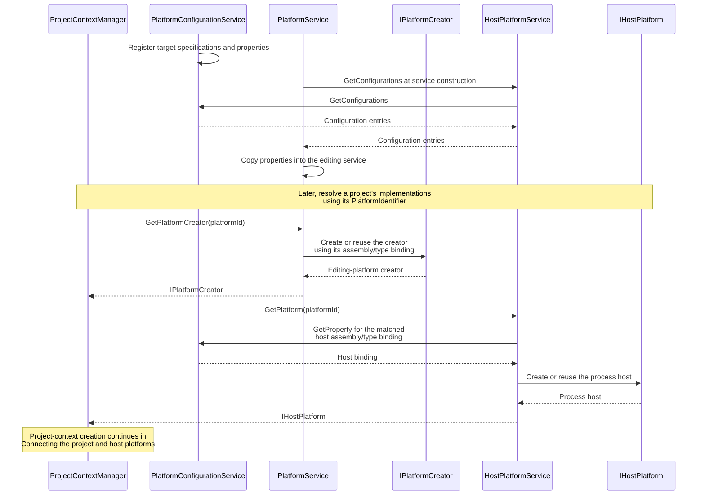
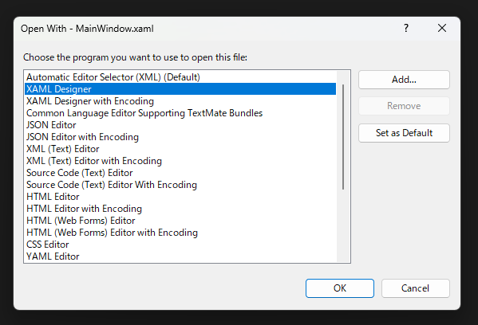
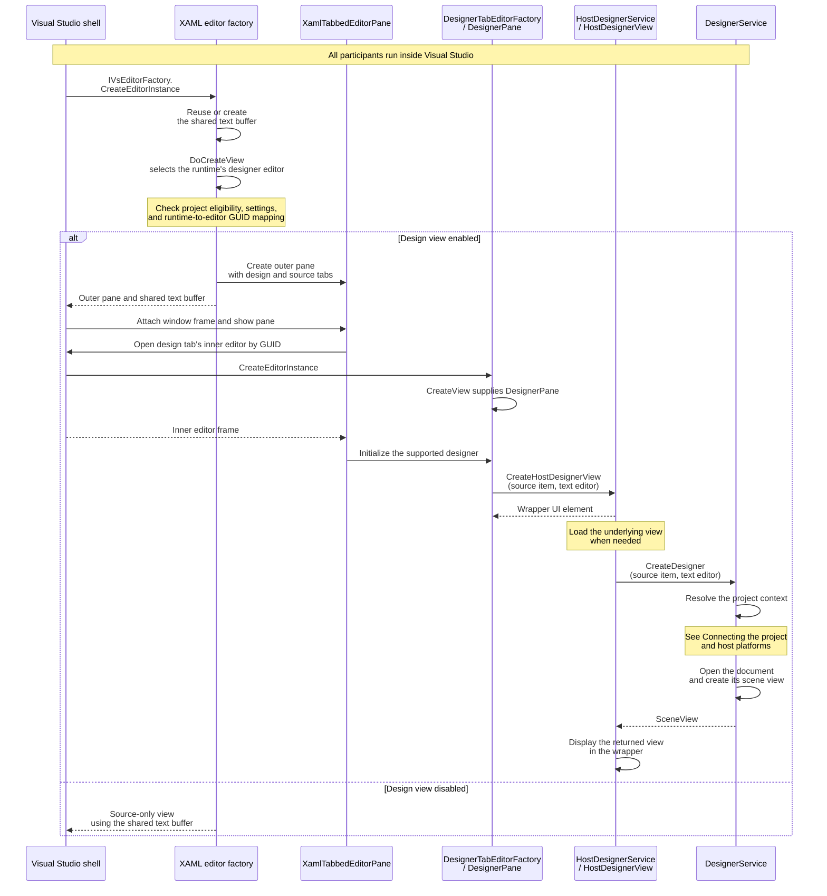
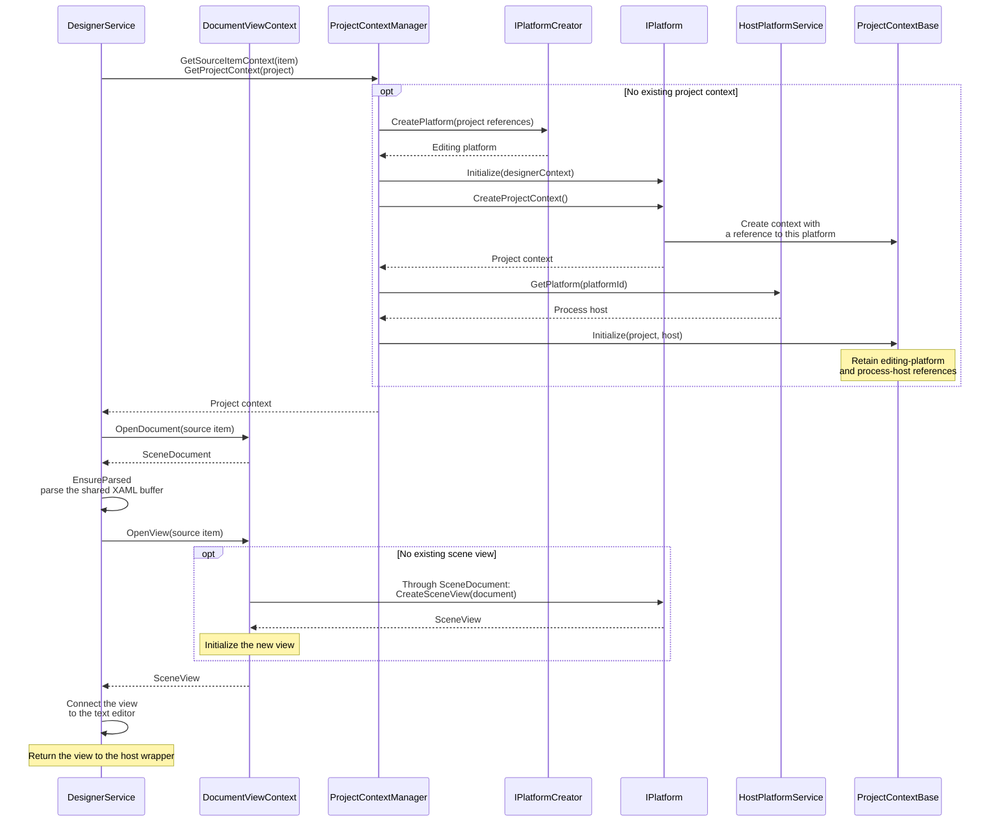
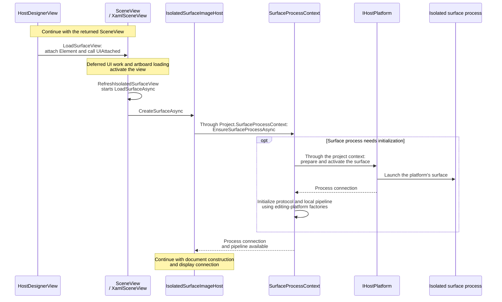
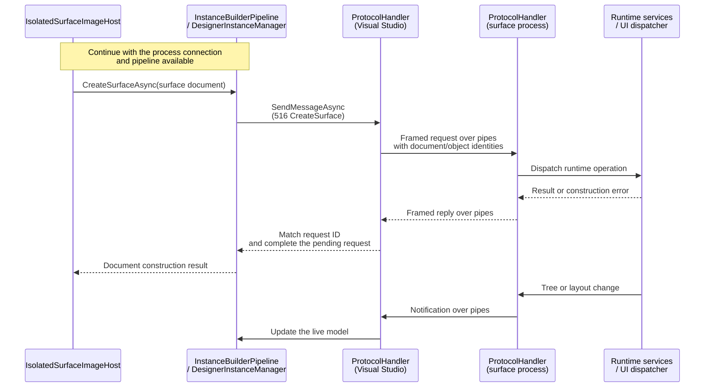
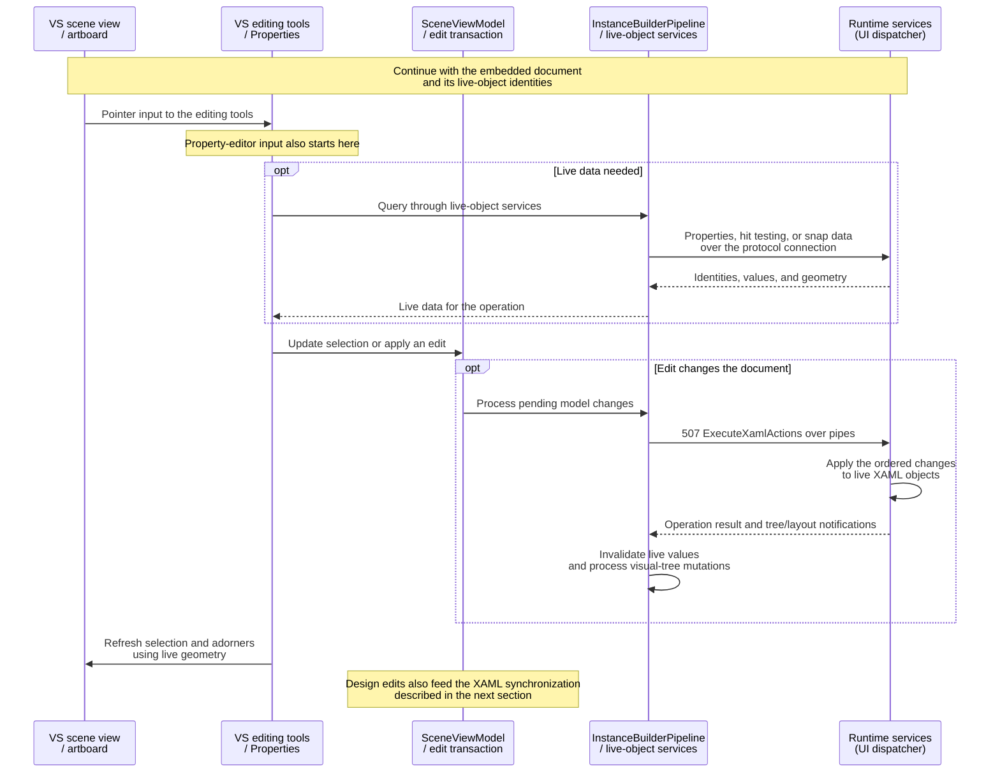
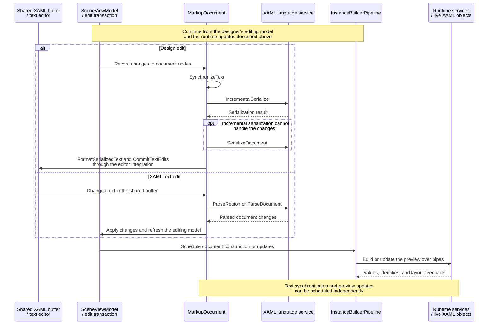

# Architecture

This page describes the shared Visual Studio XAML Designer flow. Platform-specific sequence diagrams and implementation details are in [WPF XAML Designer](wpf-designer.md), [UWP XAML Designer](uwp-designer.md), and [WinUI designer implementation](winui-designer.md).

- [Platform registration](#platform-registration)
- [Opening a XAML file](#opening-a-xaml-file)
- [Creating the designer view](#creating-the-designer-view)
- [Connecting the project and host platforms](#connecting-the-project-and-host-platforms)
- [Starting the isolated process](#starting-the-isolated-process)
- [Communicating with the surface](#communicating-with-the-surface)
- [Loading the XAML document](#loading-the-xaml-document)
- [Embedding the surface](#embedding-the-surface)
- [Handling designer operations](#handling-designer-operations)
- [Synchronizing XAML and design changes](#synchronizing-xaml-and-design-changes)
- [Toolbox integration](#toolbox-integration)
- [Error handling and lifetime management](#error-handling-and-lifetime-management)

> [!NOTE]
> Unless otherwise noted, shortened assembly names such as `DesignerHost.dll` refer to the full file name `Microsoft.VisualStudio.DesignTools.DesignerHost.dll`.

## Platform registration

Platform configuration supplies the implementation details used to create the designer backend. It is separate from the runtime-to-editor mapping that enables the design tab.

`PlatformConfigurationService` in `DesignerHost.dll` registers configurations for these platforms and targets:

- WPF on .NET Framework
- WPF on .NET Core 3.0 or later
- UWP (`UAP` 0.8 or later)
- Legacy `WindowsXaml80`
- WinUI for desktop .NET (`.NETCoreApp` 5.0 or later)
- WinUI for UAP

These are configuration matching conditions, not a statement of current product support.

Each configuration associates a target specification with properties describing the designer's editing platform, process host, metadata, and Toolbox behavior. The assembly and type entries identify two implementations: an editing-platform creator and a process host. They are instantiated when requested and cached independently.

The editing service copies the configuration properties when it is constructed. Changes to the configuration table therefore do not automatically update an editing service that already exists. The host service reads the matched configuration when a host is requested and reuses an existing host for the same platform identity.

| Configuration property | Shared role |
| --- | --- |
| `PlatformCreatorAssembly` / `PlatformCreatorType` | Identify the editing-platform creator. |
| `HostPlatformAssembly` / `HostPlatformType` | Identify the process host. |

The registered implementations determine the later platform-specific paths: [WPF process startup](wpf-designer.md#starting-the-application-and-creating-a-document), [UWP application preparation](uwp-designer.md#starting-the-application-and-creating-a-document), and [WinUI implementation bindings](winui-designer.md#platform-registration).

## Opening a XAML file

When you open Visual Studio’s **Open With** dialog for a XAML file, it lists two designer-related entries: **XAML Designer** and **XAML Designer with Encoding**. The second entry selects the encoding-aware editor factory.

These entries are registered by `MS.Internal.Package.XamlDesignerPackage` in `XamlDesignerHost.dll` as `TabbedViewEditorFactory` and `TabbedViewCodePageEditorFactory`, respectively. Both implement the Visual Studio SDK interface `IVsEditorFactory`. The package also registers Toolbox providers, which we’ll cover later.

After you select an entry, the shell asks its editor factory to open the document. The factory reuses the document's existing text buffer or creates one, then builds a view around it. The project, target platform, and editor settings determine whether that view includes the designer. Source and design views share the same buffer.

WPF and UWP use the normal designer eligibility path. WinUI starts with the design view disabled, but a runtime-specific editor mapping under `XamlDesigner\XamlRuntimes\WinUI` can enable it. The mapping must contain a valid editor-factory GUID, and the built-in designer-tab factory must be registered. Document-specific exclusions can still disable the designer. This project's [runtime registration attribute](../src/WinUIDesigner.Vsix/ProvideXamlRuntimeDesignerAttribute.cs) adds the WinUI mapping.

## Creating the designer view

The returned outer pane is a container for the design and source views. The shell first attaches it to a window frame; later display notifications cause it to populate the tabs. Each tab records which editor factory should supply its contents. Creating the container and loading the designer's contents are separate stages.

When the design tab is displayed, it asks the shell to open an inner editor using the selected GUID. The built-in designer-tab factory supplies a `DesignerPane`, which hosts the designer's UI and checks whether the project is supported.

After the compatibility checks pass, the inner pane obtains a `HostDesignerView` and places its UI element in the tab. This wrapper records the source item and text editor. The underlying designer is loaded when the view is needed, including when it becomes visible. The host integration service then obtains the shared designer implementation from `SurfaceDesigner.dll` and asks it to open the document.

Before returning the scene view, `DesignerService` resolves the project's editing and host platforms, opens the XAML document, and connects the view to the text editor. Project-context resolution is expanded in [Connecting the project and host platforms](#connecting-the-project-and-host-platforms).

## Connecting the project and host platforms

`DesignerService` asks the project context manager to resolve the source file's editing context and its project context. An existing project context is reused. For a new context, the project's target framework, SDK, and reference assemblies determine the editing platform to create or reuse. That platform supplies the project context, and the manager attaches the corresponding process host to it.

The context retains both references: the editing platform supplies document and scene services, while the host prepares and manages the display process. For UWP, these objects are `UwpProjectContext`, `UwpPlatform`, and `UwpHostPlatform`. WPF uses `WpfProjectContext`, `WpfPlatform`, and `WpfHostPlatform` through the same shared sequence.

Once the context is available, the shared XAML buffer is opened as an editing document and parsed into its XAML model. The editing platform supplies a scene view for that document. The view is connected to the text editor and returned to the wrapper that the design tab already hosts.

## Starting the isolated process

The scene view belongs to Visual Studio, but the live XAML objects belong to an isolated surface process. This keeps the project's runtime and control instances outside the editor process. When a live display connection is needed, the project context coordinates process startup and the designer's local pipeline.

When the returned scene view is attached to the host wrapper, deferred initialization and artboard loading start asynchronous surface loading through the view's image host. The image host uses the project's process context to ensure the isolated process and local pipeline are available before constructing the document. Surface loading can finish after the scene view has been returned.

The host selects the target architecture and runtime, then prepares a shadow cache containing the surface executable, project assemblies, resources, and diagnostics files. The editing platform supplies the markup provider and instance-building components. These components remain inside Visual Studio and connect its editing model to the remote objects.

The launch path depends on the platform:

| Platform | Process preparation and activation |
| --- | --- |
| WPF | Stage the desktop surface and launch it with pipe initialization data. |
| UWP | Prepare and register a designer app package, activate its app view, and initialize its TAP. |
| This WinUI extension | Reuse the WPF .NET host and shadow-copy worker, then launch the extension's WinUI surface. Reuse UWP editing services with WinUI-specific document and display adapters. |

Platform-specific startup: [WPF process startup and document creation](wpf-designer.md#starting-the-application-and-creating-a-document), [UWP application startup and document creation](uwp-designer.md#starting-the-application-and-creating-a-document), and [WinUI startup](winui-designer.md#starting-the-isolated-process).

## Communicating with the surface

Two anonymous pipes carry traffic in opposite directions. Their handles must be duplicated or inherited into the receiving process; passing a numeric handle as text alone does not establish a connection. Each side has a protocol handler that sends requests, matches replies to pending requests, and receives notifications.

The wire format is shared with Visual Studio's designer services:

| Part | Format |
| --- | --- |
| Header | Four 32-bit integers: remaining byte length, message type, message ID, and request ID. |
| Request/reply correlation | A reply identifies the original request; common replies use message type `1`. |
| Payload | Data-contract JSON encoded as UTF-16LE, or a contract-specific binary format. |
| Runtime identities | Serialized document IDs and object handles, resolved by the receiving service. |

The runtime applies XAML operations on its UI thread. Connection initialization and runtime dispatch implementations are described in [WPF](wpf-designer.md#starting-the-application-and-creating-a-document), [UWP](uwp-designer.md#starting-the-application-and-creating-a-document), and [WinUI](winui-designer.md#communicating-with-the-surface).

## Loading the XAML document

Visual Studio prepares a design-time representation of the editing document. It can send XAML to load or construction actions describing objects, properties, and collection contents. Application resources and design-time resources are separate documents included with the edited document.

The instance manager prepares a platform-specific construction request for the target document and any required application resources. The runtime returns construction results and live-object identities. A successful construction reply completes document creation; the view connects the display in a later stage. Object handles identify runtime objects and are separate from the display window.

Document preparation, runtime identities, and loading alternatives: [WPF](wpf-designer.md#starting-the-application-and-creating-a-document), [UWP](uwp-designer.md#starting-the-application-and-creating-a-document), and [WinUI](winui-designer.md#loading-the-xaml-document).

## Embedding the surface

Visual Studio supplies the artboard, selection adorners, and editing tools. The isolated process supplies the rendered XAML content. The scene view must connect that content to the artboard and keep the display coordinates aligned with the editing tools.

| Platform | Display connection |
| --- | --- |
| WPF | Attach the remote surface's child HWND to the designer's holder window. |
| UWP | Obtain the app view's visual and connect it to a DirectComposition target in Visual Studio. |
| This WinUI extension | Host the document in `DesktopWindowXamlSource` and attach its window beneath the designer's overlay. |

Viewport size, preview device size, and pan/zoom are separate values. The viewport clips the visible area, device size controls the document's layout, and pan/zoom transforms its content. Keeping these separate allows the overlay, runtime bounds, and hit-test coordinates to agree as the user scrolls or zooms. Layout, bounds, and DPI notifications update the frontend's live view of the surface.

Display connection sequences: [WPF child-window hosting](wpf-designer.md#embedding-the-surface), [UWP DirectComposition](uwp-designer.md#embedding-the-surface), and [WinUI window hosting](winui-designer.md#embedding-the-surface).

## Handling designer operations

The designer's tools run inside Visual Studio. They turn pointer input into selection, insertion, movement, and resizing of editing-model nodes. The surface answers questions about the live objects and applies the resulting runtime changes. Object handles and source information connect the editing nodes to those objects. The live visual tree also contains template-generated children beyond the nodes explicitly authored in XAML.

The operation groups include property queries, hit testing, snapping, object and collection changes, and state or animation preview. The editing platform connects these shared tools to the runtime's types, metadata, and live geometry.

During a drag, the shared designer updates temporary edits and commits or cancels the final transaction. Its pipeline invalidates cached live values after processing changes and uses runtime geometry to refresh adorners. Rendering suspension is separate from editing transactions and cache invalidation.

The UWP [document/view association](uwp-designer.md#starting-the-application-and-creating-a-document) connects these shared operations to its live content. The extension's runtime services are described in [WinUI designer operations](winui-designer.md#handling-designer-operations).

## Synchronizing XAML and design changes

The shared text buffer and Visual Studio's XAML document model are the editing state. The surface holds the live preview of that model. Text edits are parsed into document changes, which the designer pipeline applies to the runtime tree. Design edits change the same document model through editing transactions, and the language service writes those changes back into the shared buffer.

For design edits, the language service first attempts incremental serialization. Changes that cannot be serialized incrementally cause the document to be serialized as a whole. The serializer handles namespace declarations, markup extensions, property elements, and collection content; text edits are formatted and committed through the shared editor integration.

Parsing and serialization have guards against feeding their own changes back into another edit. Hidden design-time properties are also excluded from normal serialization. Undo and redo use the shared designer and editor history, with corresponding runtime changes processed by the instance pipeline. Runtime notifications refresh the live model; they do not independently save the XAML file.

Text parsing and serialization are provided by Visual Studio's `Markup.dll` and XAML language service. The runtime adapter preserves document/object correspondence and reports live-tree and layout updates. See [UWP document preparation](uwp-designer.md#starting-the-application-and-creating-a-document) and [WinUI synchronization](winui-designer.md#synchronizing-xaml-and-design-changes).

## Toolbox integration

Toolbox integration has three entry points. Static registration supplies standard controls, discovery supplies selectable types from assemblies, and automatic population watches project or package references. The configuration flag enabling automatic population does not itself discover controls.

A Toolbox item describes a type to create. On insertion, the shared tools decode the asset, resolve required references, select the insertion point, and apply placement and default values through an editing transaction. The ordinary XAML synchronization and runtime update paths then handle the new control.

Toolbox groups, discovery providers, and the supported control types depend on the platform. See [WinUI Toolbox integration](winui-designer.md#toolbox-integration) for the extension's providers and limitations.

## Error handling and lifetime management

Failures can occur before the surface starts, while the connection initializes, during document construction, or after the preview is displayed. A created tab, running process, or successful construction reply proves only that particular stage completed.

Document closure, display teardown, connection shutdown, and process lifetime are separate stages. The common infrastructure coordinates document ownership, cancellation, live-object caches, and process-exit notifications. Platform adapters release their own runtime, display, and staging resources.

Failure conditions and disposal paths: [WPF](wpf-designer.md#error-handling-and-lifetime-management), [UWP](uwp-designer.md#error-handling-and-lifetime-management), and [WinUI](winui-designer.md#error-handling-and-lifetime-management).
