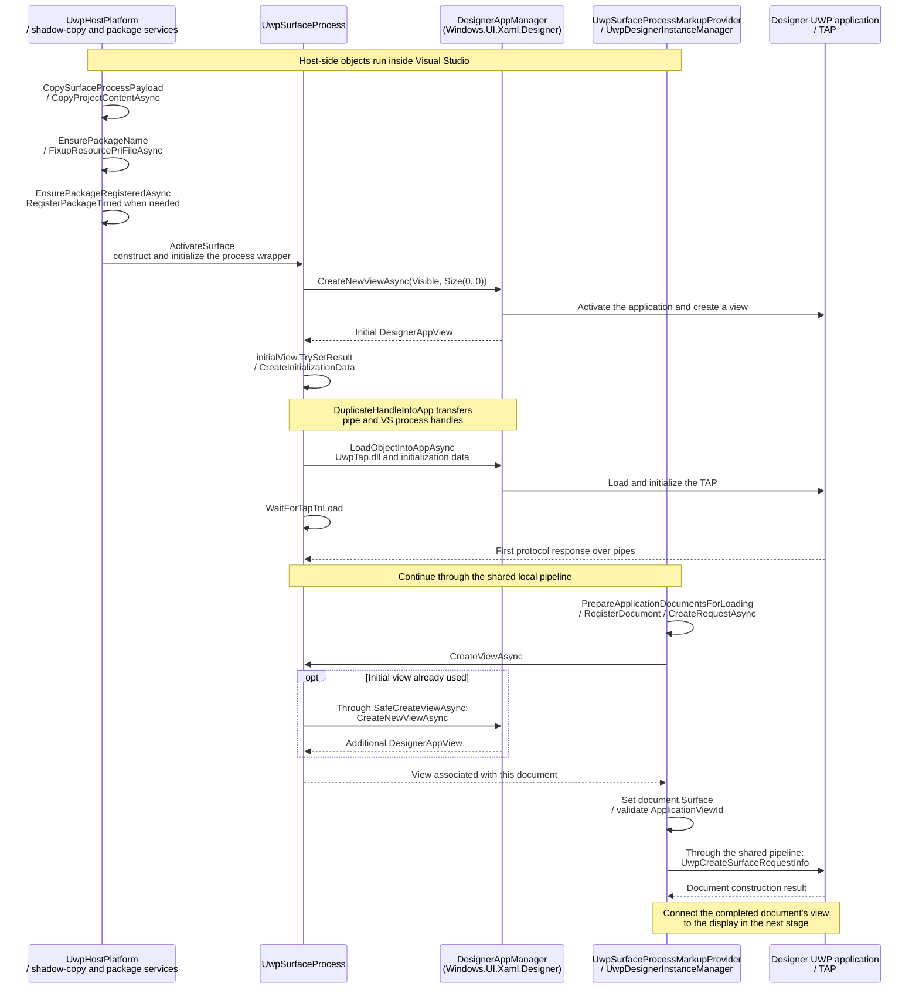
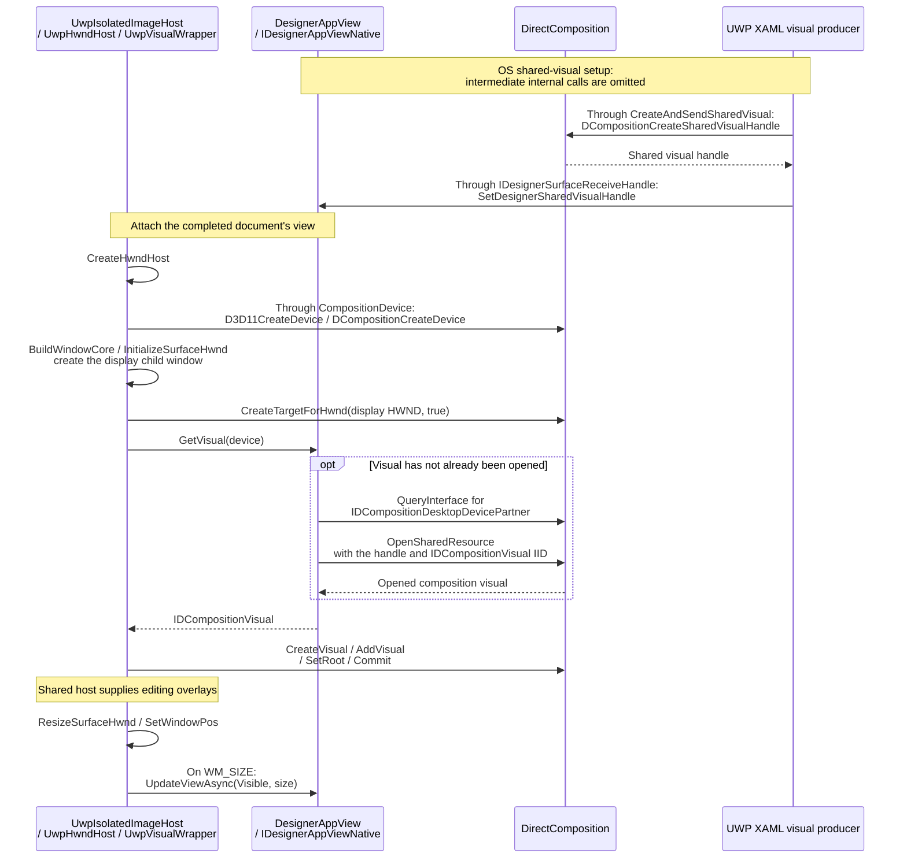
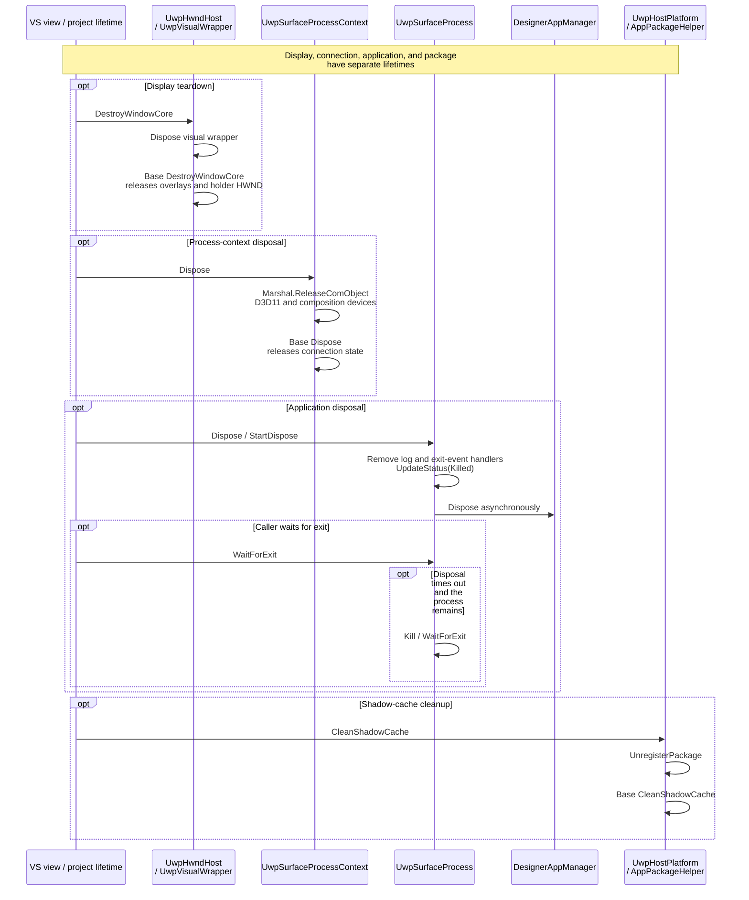

# UWP XAML Designer

This page follows the UWP application and display paths behind the [shared designer flow](architecture.md). The editor, document model, and editing tools run in Visual Studio. A separate designer application holds and renders the live `Windows.UI.Xaml` objects.

- [Starting the application and creating a document](#starting-the-application-and-creating-a-document)
- [Embedding the surface](#embedding-the-surface)
- [Error handling and lifetime management](#error-handling-and-lifetime-management)

> [!NOTE]
> Unless otherwise noted, shortened assembly names such as `DesignerHost.dll` refer to the full file name `Microsoft.VisualStudio.DesignTools.DesignerHost.dll`.

## Starting the application and creating a document

When a live preview is needed, the host stages a designer application and the project's content, establishes its package identity, and registers the package for the current user. The manifest, resource index, and access permissions must be ready before activation.

The host then creates an application view, transfers valid communication handles, and loads the diagnostics TAP. Once communication is ready, the editor associates the document with an application view and sends its construction request. The shared protocol and pipeline steps are described in the [main document](architecture.md#communicating-with-the-surface).

The initial view becomes available before TAP initialization finishes, and can be used by the first document. Later requests can obtain additional views. The view identity selects the UWP display context; document and object identities connect editing operations to its runtime content.

Application resources can come from compiled App XBF or prepared application XAML. A previous loading or construction failure can cause the next request to include construction actions and prepared application XAML. After construction completes, the image host connects the selected view to the artboard.

## Embedding the surface

The UWP runtime supplies a shared composition visual for the document's application view. Visual Studio creates a display child window, opens the shared visual using its composition device, and attaches it to a local DirectComposition target.

The artboard and editing overlays remain in Visual Studio. The remote application supplies the rendered XAML content, while the local windows provide its display location and the layers used by the editing tools.

The visual is shared through an OS handle, and an already-opened visual can be reused. This connects the remote rendering to Visual Studio's display target without moving the application's display window into the editor.

Resizing the local display window updates the application view's viewport. Overlapping resize work is suppressed, and the final window size is checked again after completion. Preview device size, orientation, pan, and zoom remain separate from this viewport synchronization.

## Error handling and lifetime management

UWP-specific failures can occur while checking the target runtime, preparing or registering the package, creating an application view, loading the TAP, or associating a document with a view. Application-exit notifications update the editor's process state and cancel unfinished view creation.

Display teardown, connection disposal, application shutdown, and package cleanup have separate lifetimes. Closing a display releases its local windows; disposing the connection releases its composition devices; ending application management requests application shutdown.

Application disposal is asynchronous. A caller waiting for exit can attempt to terminate a process that remains after the timeout. Package removal belongs to cache replacement and cleanup, including cleanup of older registrations during idle work.

Closing a document therefore does not necessarily remove its package registration. Which views and processes remain also depends on the shared project and document ownership rules.
