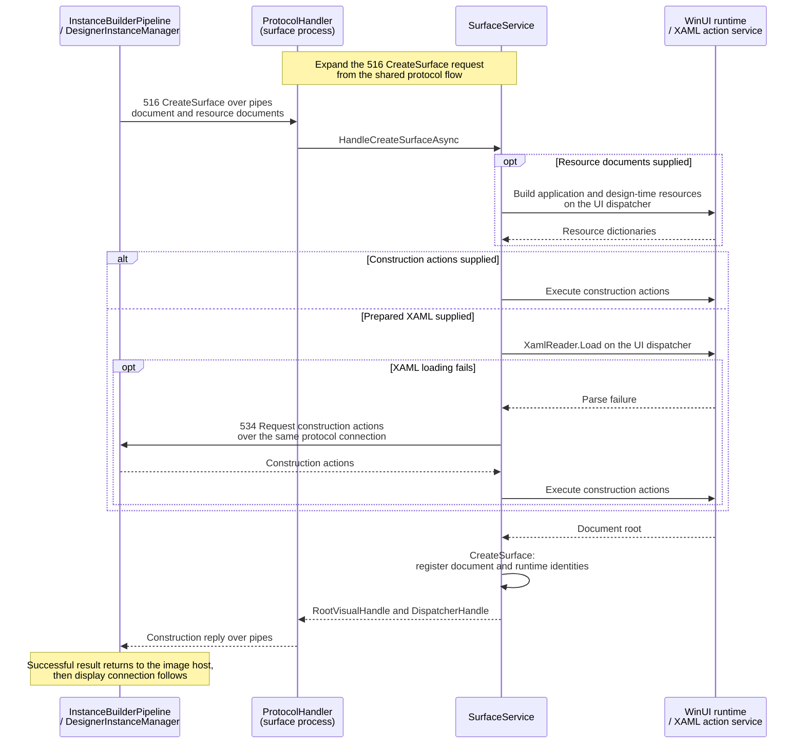
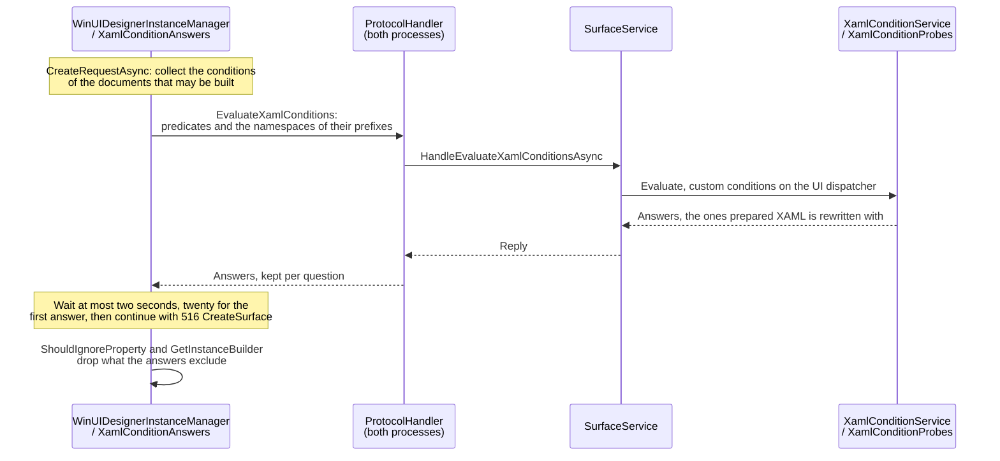
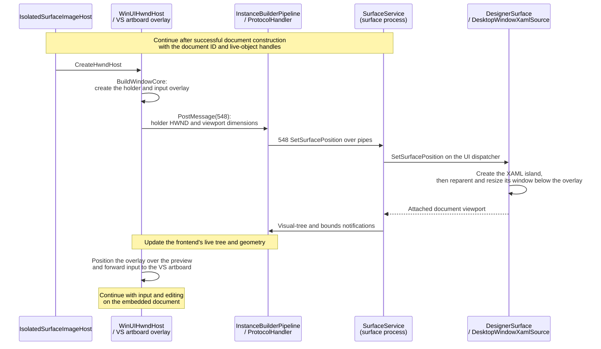
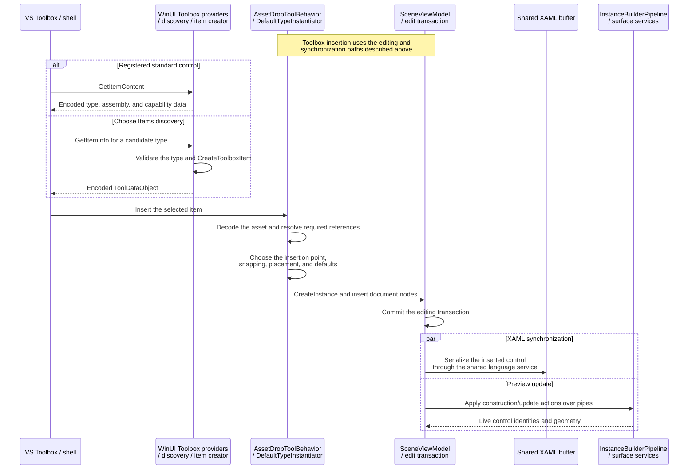
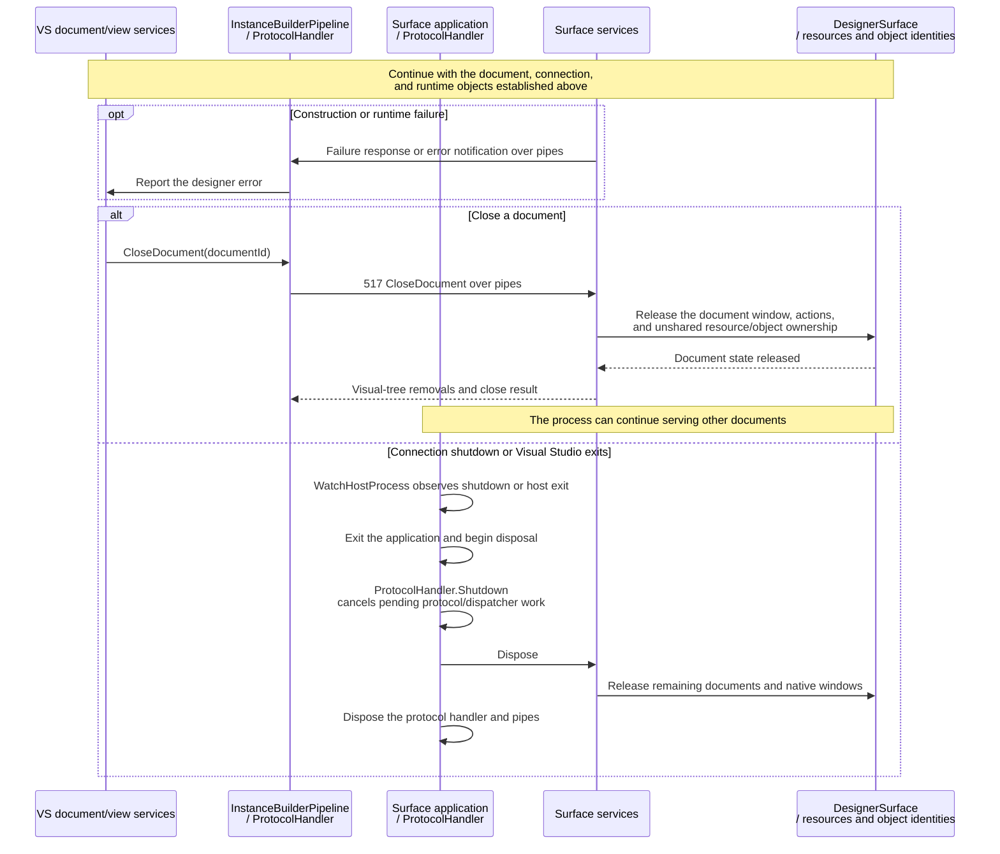

# WinUI designer implementation

This page describes the WinUI extension's implementation bindings, runtime, display adapters, and Toolbox providers. See [Architecture](architecture.md) for the shared designer flow and [UWP XAML Designer](uwp-designer.md) for the built-in UWP implementation.

- [Platform registration](#platform-registration)
- [Starting the isolated process](#starting-the-isolated-process)
- [Communicating with the surface](#communicating-with-the-surface)
- [Loading the XAML document](#loading-the-xaml-document)
- [Embedding the surface](#embedding-the-surface)
- [Handling designer operations](#handling-designer-operations)
- [Synchronizing XAML and design changes](#synchronizing-xaml-and-design-changes)
- [Toolbox integration](#toolbox-integration)
- [Error handling and lifetime management](#error-handling-and-lifetime-management)

> [!NOTE]
> Unless otherwise noted, shortened assembly names such as `DesignerHost.dll` refer to the full file name `Microsoft.VisualStudio.DesignTools.DesignerHost.dll`.

## Platform registration

The extension supplies the implementation bindings omitted by the built-in WinUI configuration. The following configuration examples show the WPF host binding and the desktop WinUI baseline.

For example, the configurations of .NET Framework WPF and WinUI for desktop .NET are registered as follows:

```csharp
RegisterPlatformConfiguration(WpfSpecification, new Dictionary<string, string>
{
    { "PlatformCreatorAssembly", "Microsoft.VisualStudio.DesignTools.WpfSurfaceDesigner" },
    { "PlatformCreatorType", "Microsoft.VisualStudio.DesignTools.WpfSurfaceDesigner.WpfFrameworkPlatformCreator" },
    { "HostPlatformAssembly", "Microsoft.VisualStudio.DesignTools.XamlDesignerHost.dll" },
    { "HostPlatformType", "Microsoft.VisualStudio.DesignTools.WpfDesignerHost.WpfHostPlatform" },
    { "ReferenceAssemblyMode", "TargetFramework" },
    { "PlatformSurfaceIsolatedGuid", "{ABC03A4E-B0A1-41B7-97BA-BB178F354CCD}" },
    { "SupportsToolboxAutoPopulation", "true" },
    { "ToolboxPage", "{7C9BECBA-12B9-4480-9DBF-2345AA3C4F9A}" },
    { "DesignerTechnology", "Microsoft:System.Windows:WPF" },
    { "ClipboardFormat", "CF_WINFX_TOOL" },
    { "ProjectFlavor", "{60dc8134-eba5-43b8-bcc9-bb4bc16c2548}" }
});
```

```c#
RegisterPlatformConfiguration(winuiSpecification, new Dictionary<string, string>
{
    { "DefaultTargetFramework", ".NETCoreApp, Version=5.0" },
    { "SupportsToolboxAutoPopulation", "true" },
    { "SupportsExtensionSdks", "false" },
    { "ToolboxPage", "{8A63BDE2-AEB9-4AF9-A00D-DBC9BD7D509C}" },
    { "DesignerTechnology", "Microsoft:Microsoft.UI.Xaml" },
    { "ClipboardFormat", "CF_WINDOWSUIXAML_TOOL" },
    { "AppPackageType", "WindowsXaml" }
});
```

The built-in WinUI configurations omit both assembly/type pairs. They contain other properties used by designer tools, but do not supply an editing platform or process host. The runtime mapping can still enable a design tab; this project's [platform registration](../src/WinUIDesigner.Vsix/WinUIDesignerPackage.cs) also supplies the missing implementation bindings.

The extension updates the existing desktop WinUI configuration and installs a creator hook that returns its WinUI creator, cached per editing service. This also covers services whose configuration snapshot predates the update. Calls for other XAML runtimes continue through Visual Studio's original implementation. Both the configuration changes and hook follow the extension package's lifetime.

## Starting the isolated process

For this extension, the project architecture selects `WinUISurface.x64.exe` or `WinUISurface.arm64.exe`; the selected executable is staged as `WinUISurface.exe`. Project media and library PRI files are also staged for resource lookup. Startup passes the Visual Studio process ID, diagnostics TAP path, pipe initialization data, DPI context, and Visual Studio installation root. The surface uses that root to resolve private designer contracts from the Visual Studio installation that launched it, initializes the WinUI application and dispatcher, registers its services, and starts receiving messages.

Implementation: [scene-view activation](../src/WinUIDesigner.Vsix/Platform/WinUISceneView.cs), [project context](../src/WinUIDesigner.Vsix/Platform/WinUIProjectContext.cs), [process host and staging](../src/WinUIDesigner.Vsix/DesignerHost), [local process context](../src/WinUIDesigner.Vsix/Platform/WinUISurfaceProcessContext.cs), and [surface startup](../src/WinUIDesigner.Surface/Program.cs).

## Communicating with the surface

The surface uses the existing private protocol types and adds a pipe bridge compatible with the host's initialization data. Its frame reader assembles complete messages even when reads return partial data. WinUI operations are marshalled to the UI dispatcher; the receive thread does not directly mutate XAML objects. Service observers are registered before protocol startup so an early request can be handled.

Implementation: [pipe bridge](../src/WinUIDesigner.Surface/Transport/SurfacePipeDataBridge.cs), [frame reader](../src/WinUIDesigner.Surface/Transport/MessageFrameReader.cs), and [service initialization](../src/WinUIDesigner.Surface/App.xaml.cs).

## Loading the XAML document

The surface first prepares application and design-time resources, then constructs the edited document on its UI thread. When XAML loading fails and actions were not supplied, it asks Visual Studio for construction actions. This alternative also lets the designer build objects individually and associate failures with the editing model.



In this extension, the markup provider prepares App.xaml and design-time resources without using the application's compiled App XBF, following the UWP and WPF providers' preparation flow. The instance manager follows UWP's App.xaml request policy: it sends the document while it is prepared, includes construction actions after an instance-building failure, and uses the UWP provider's eviction signal to choose the normal loading path. Prepared design-time resources follow WPF's state check. The surface retains these shared resource dictionaries across target-document rebuilds; when App.xaml is omitted from a later request, its last theme and resource configuration remains active. When a prepared resource document is sent again, the surface replaces its cached dictionary so edits take effect while keeping application resources before design-time resources. It then loads prepared XAML with WinUI's XAML reader or executes construction actions through its action service. Staged project assemblies, XAML metadata providers, and PRI files supply custom types and resources.

The surface records stable runtime identities and source information, and reports visual-tree changes to Visual Studio. The returned root handle identifies an object; it is separate from the window used to display it. A successful construction reply therefore completes document creation, while embedding happens in the next stage.

Implementation: [document preparation](../src/WinUIDesigner.Vsix/Platform/WinUIDesignerInstanceManager.cs), [construction and tree notifications](../src/WinUIDesigner.Surface/Services/SurfaceService.cs), and [project type/resource resolution](../src/WinUIDesigner.Surface/Runtime/ProjectRuntimeResolver.cs).

### Merged resource dictionaries

A dictionary merged through `ResourceDictionary.Source` contributes its resources to the preview: in the edited document, in App.xaml and in the design-time resources, together with the dictionaries it merges in turn.

```xml
<ResourceDictionary.MergedDictionaries>
    <ResourceDictionary Source="ms-appx:///Themes/ConditionalResources.xaml" />
    <ResourceDictionary Source="ms-appx:///Some.Library/Themes/Styles.xaml" />
</ResourceDictionary.MergedDictionaries>
```

The surface cannot follow such a source by itself. `WinUISurface.exe` is not the application's package, so `ms-appx:///` does not lead to the project's files, and compiled XAML in a PRI file is nothing the XAML reader can read. Visual Studio delivers the XAML instead, with the machinery of its UWP designer:

1. When Visual Studio's XAML cleaner prepares a document, `UwpResourceDictionaryCleanerHandler` resolves every `Source` against the document, also by assembly name into a referenced project, and calls `SurfaceProcessMarkupProvider.RegisterRelatedDocument`. That registers the dictionary as a related document, cleans it like any document, and writes the prepared copy into the shadow cache, the folder the surface reads documents from. The UWP designer skips this for an unchanged dictionary when the application has a compiled App.xbf; the host of this extension has none (`WpfHostShadowCopyWorker.HasAppXbf` is false), so every dictionary is prepared.
2. The cleaner replaces the attribute with the design-time property `DT.ResourceDictionarySource` of `using:XSurfUwp`. Its value is the design-time URI of the copy, such as `ms-appx:///Some.Library/Themes/~vs]~1234~Styles.xaml`, which names the file `Some.Library\Themes\~vs]~1234~Styles.xaml` below the shadow cache.
3. Construction actions carry the same value: for a `Source`, `UwpDesignerResourceDictionaryBuilder` calls `DesignerInstanceBuilderUtility.SetDesignTimeResourceDictionarySource`, which prepares the copy the same way and sets the property `ResourceDictionarySource:XSurfUwp.DT`.

Microsoft's UWP surface hands that value to a native function (`XSurfUwp.DT.SetResourceDictionarySource` calls `UpdateResourceDictionarySource` of `Microsoft.VisualStudio.DesignTools.UwpTap.dll`). The WinUI surface reads the prepared copy itself, applies the [namespace policies](#namespace-policies) to it, expands the sources it contains, and merges the result into the dictionary that carried the source. Visual Studio prepares every copy before it sends the document, so no message of this extension is involved.

| Path | What the surface does |
| --- | --- |
| Prepared XAML | Before the XAML reader runs, the content of the copy is inserted as the last merged dictionary of the element that carried the source. The document and its dictionaries load in one pass, so a `StaticResource` of the document finds what the dictionaries define. |
| Construction actions | When the property is set, the dictionary is read on its own with the XAML reader and added as the last merged dictionary of the object Visual Studio created. Clearing the property removes it again. |

The last merged dictionary is looked up first, as the entries of a `Source` win over the dictionaries merged inline at run time. Each merge gets an object of its own, as at run time; a dictionary merged in several places is read and rewritten once.

Inserting one document into another has to respect two rules of the WinUI reader, measured with Windows App SDK 2.5.1. It accepts `mc:Ignorable` on the root element only, so what an inserted dictionary declares ignorable is removed, as the reader would skip it. And it reads the prefix of an element name with the outermost declaration of that prefix, so a prefix of the inserted dictionary that the document binds to another namespace is renamed, in its declaration and in the attribute values that use it. This matters in practice: Visual Studio's cleaner names its own prefixes `_0`, `_1` and so on in every file, for different namespaces.

What a merged dictionary sees while it loads differs between the paths:

| Situation | Prepared XAML | Construction actions | WinUI at run time |
| --- | --- | --- | --- |
| A `StaticResource` to the application's resources | Found | Found | Found |
| In App.xaml, a `StaticResource` to a dictionary merged earlier | Found | Found: Visual Studio attaches each object to its parent before it sets its properties (`BuildOrder.AttachThenInitialize`) | Found |
| In a page, a `StaticResource` to a dictionary merged earlier | Found | Not found | Not found |

A dictionary that Visual Studio does not find in the solution, such as one compiled into a NuGet package or a binary reference, keeps its source. The surface asks the WinUI runtime to load it, whose resource manager also looks into the PRI files staged from the project; when that succeeds the dictionary is merged with its source, otherwise it is left out. The namespace policies do not apply to such a dictionary, as to any dictionary the reader loads by itself.

Elements of an inserted dictionary are not offered as the source of live elements: their line numbers belong to another file.

#### When a dictionary cannot be merged

Every dictionary that cannot be merged is left empty and reported once per request as a warning in the log, which names the dictionary, the document or dictionary that merges it, and the reason. The document goes on loading.

| Situation | Result |
| --- | --- |
| The prepared copy does not exist or cannot be read | Left empty. |
| The copy is not well-formed XML, or its root element is not a resource dictionary | Left empty. |
| The source is not in the solution and the runtime cannot load it | Left empty. |
| A chain of dictionaries reaches a member of the chain again, such as `A.xaml → B.xaml → A.xaml` | The repeated reference is left empty; the message lists the chain. |
| Dictionaries are nested more than 32 levels deep | The deeper ones are left empty. |
| The XAML reader rejects a dictionary inserted into prepared XAML | The prepared document fails to load, and the surface asks for construction actions as for any document. On that path each dictionary loads on its own, and only the one the reader rejects is reported and left empty. |
| The XAML reader rejects a dictionary on the construction-action path | Left empty. |

A dictionary left empty can still make the document fail when the document uses its resources, as at run time.

#### Caching and edits

The surface keeps each dictionary it read from a prepared copy, with the policies applied and its own sources expanded, for as long as the copy and every copy merged into it have the text they had; the text is compared rather than the time stamp. Whether the runtime loads a source outside the solution is remembered for the lifetime of the surface process.

Visual Studio prepares a related document once while it is registered and does not prepare it again when it is edited; nothing reaches the surface. An edit of a merged dictionary therefore appears when the designer is reloaded, which starts a new surface process and prepares every document again. Reopening a page is not enough while the dictionary stays registered. Updating an open preview while its dictionary is edited is not implemented.

Implementation: [source URIs](../src/WinUIDesigner.Surface/Markup/ResourceDictionarySourceUri.cs), [expansion](../src/WinUIDesigner.Surface/Markup/ResourceDictionarySourceExpander.cs), [insertion into a document](../src/WinUIDesigner.Surface/Markup/XamlFragmentGrafter.cs), [cache](../src/WinUIDesigner.Surface/Markup/PreparedResourceDictionaryCache.cs), and [surface integration](../src/WinUIDesigner.Surface/Services/SurfaceService.ResourceDictionarySources.cs). The [sample page](../samples/WinUIDesignerSampleApp/ConditionalXamlPage.xaml) merges a dictionary itself and uses one that [App.xaml](../samples/WinUIDesignerSampleApp/App.xaml) merges through [a dictionary that merges another](../samples/WinUIDesignerSampleApp/Themes/SourceResources.xaml).

### Namespace policies

Some members of a document apply only under a condition: those under a conditional XAML namespace (`xmlns:c7="...?IsApiContractPresent(...)"`) and those under an Uno Platform prefix (`win:`, `android:`, `not_win:`). A namespace policy classifies the members written under one `xmlns` prefix. It can keep them as plain members of their bare namespace, drop them, or leave them as written. The platform policy decides first, then the conditional policy. The platform policy currently leaves every prefix alone; the sections below describe each policy.

The decision is made per prefix, not per namespace: `win`, `not_android`, and the default namespace all name the presentation namespace. Neither LINQ to XML nor the designer's document model keeps the prefix a member was written with, so both sides read it back from the source text.

The policies apply on both loading paths, so a member is treated the same way on either.

| Path | Where the policies apply |
| --- | --- |
| Prepared XAML | The surface parses the prepared XAML once, rewrites that document, and passes the result to the XAML reader. Source mapping uses the same document: a dropped element cannot claim a source position, and line information still refers to the prepared file. XAML snippets that are parsed on their own go through the same rewrite. |
| Construction actions | Actions carry CLR names only, so the surface cannot tell which prefix a member had. The instance manager asks, for each property it is about to build, whether the property was written under a dropped prefix. An element under a dropped prefix gets an instance builder that creates nothing; the root is exempt. |

A document without a policy namespace is recognized early and is not processed further: the surface looks at its `xmlns` declarations, and the Visual Studio side scans the text once each time it changes. A policy that fails is logged and skipped; it does not fail document construction.

Implementation: [policies and namespace scanning](../src/WinUIDesigner.Shared/Markup), [XAML rewriting](../src/WinUIDesigner.Surface/Markup/XamlNamespaceRewriter.cs), [surface integration](../src/WinUIDesigner.Surface/Services/SurfaceService.NamespacePolicies.cs), and [document-model filtering](../src/WinUIDesigner.Vsix/Platform/XamlMemberDispositionService.cs).

#### What the WinUI XAML reader does on its own

`XamlReader.Load` already implements both features for XAML text. Measured with Windows App SDK 2.5.1 in a standalone application:

| Markup | Result |
| --- | --- |
| Attribute, element, setter, merged dictionary, or property element under `IsApiContractPresent` / `IsApiContractNotPresent` | Applied when the condition holds, skipped otherwise. |
| The same property set under two complementary conditions | The branch whose condition holds is applied, in either attribute order. |
| `IsTypePresent`, `IsPropertyPresent` | Evaluated against Windows Runtime metadata. `Microsoft.UI.Xaml` types and the properties they declare count as present; see [Conditional namespaces](#conditional-namespaces) for the exact rules and for the surface process, where they do not. |
| A condition on a `using:` namespace | Evaluated. |
| A custom `IXamlCondition` | `Evaluate` is called once per argument. |
| A custom condition whose type cannot be resolved | The process ends with an access violation; no exception is raised. |
| The same `x:Key` in two complementary branches | One entry; no error. It is the branch that holds, except in a dictionary that also contains a style: there it is the entry written last. |
| An element or attribute under a prefix listed in `mc:Ignorable`, including a `#using:` URI and an element inside a typed collection | Skipped. |
| An element or attribute in an unknown namespace that is not ignorable | `XamlParseException`. |
| A `win:` attribute on an element from a `using:` namespace | `XamlParseException`: the property is not found. |
| An event handler attribute, prefixed or not | Accepted and ignored. |
| `x:Class` on the root | `XamlParseException`. |

Prepared XAML that reaches the reader unchanged is therefore loaded correctly in an application. The policies cover what the reader cannot: the construction-action path, source mapping of skipped elements, the conditions that end the process or are answered differently in the surface process, and previewing the markup for another Windows version or platform.

#### Conditional namespaces

A conditional namespace carries a predicate after a `?`. The members written under its prefix exist only when the predicate holds:

```xml
<Page xmlns="http://schemas.microsoft.com/winfx/2006/xaml/presentation"
      xmlns:cond="using:MyApp"
      xmlns:c8="http://schemas.microsoft.com/winfx/2006/xaml/presentation?IsApiContractPresent(Windows.Foundation.UniversalApiContract,8)"
      xmlns:c8n="http://schemas.microsoft.com/winfx/2006/xaml/presentation?IsApiContractNotPresent(Windows.Foundation.UniversalApiContract,8)"
      xmlns:newExp="http://schemas.microsoft.com/winfx/2006/xaml/presentation?cond:FeatureFlagCondition(NewExperience)">
    <StackPanel>
        <Border c8:CornerRadius="8" c8n:CornerRadius="0" />
        <newExp:InfoBar Title="New experience" IsOpen="True" />
    </StackPanel>
</Page>
```

The designer evaluates every predicate itself. The policy turns the answer into a verdict: the members are kept when the predicate holds and dropped when it does not. In the surface, the rewritten document contains no conditional namespace any more: a kept element moves to the bare namespace, a kept attribute loses its prefix, a dropped member is removed, and every decided declaration is bound to the bare namespace, because the prefix may still occur in an attribute value such as `TargetType="c8:Button"`. The root element is never removed.

The reader evaluates predicates as well, so the rewrite needs a reason. There are four:

- **The reader ends the process on predicates it cannot handle.** That happens without an exception, so nothing can be caught; the table below lists the cases. A typing error in a predicate, or a custom condition of a project that has not been built, would close the surface.
- **The reader answers differently in the surface process.** It answers `IsTypePresent` and `IsPropertyPresent` from `.winmd` files beside the executable. The surface is a single-file executable without them, so the reader there considers no `Microsoft.UI.Xaml` type present.
- **Source mapping** must not offer an element of the branch that does not apply as the source of a live element.
- **The construction-action path** has no reader at all; both paths have to give the same members.

##### Evaluating a predicate

A predicate is written `Name(arguments)` or `prefix:Name(argument)`, with nothing before the name and nothing after the closing parenthesis. The answers are kept per question, not per predicate: `IsApiContractPresent(X,7)` and `IsApiContractNotPresent(X,7)` ask one question, which is asked once. The two branches of an if/else pair therefore never both apply, in whichever order they are written. Answers are kept for the lifetime of the surface process, as the reader keeps them for the lifetime of an application.

| Predicate | Answered by |
| --- | --- |
| `IsApiContractPresent(contract, major)`, `IsApiContractPresent(contract, major, minor)`, and the `...NotPresent` forms | `ApiInformation.IsApiContractPresent` of the machine the designer runs on. |
| `IsTypePresent`, `IsPropertyPresent` and the `...NotPresent` forms, with a `Windows.*` type | `ApiInformation.IsTypePresent` and `IsPropertyPresent`: the metadata of the operating system. |
| The same with any other type | The metadata where it can be read, otherwise the projection assemblies. A type is present when it is a Windows Runtime type. A property is present on the type that declares it and not on derived types; events and the members of structures are not properties. A class that is only managed code, such as a control of the previewed project, is not present. |
| `prefix:Type(argument)`, or `Type(argument)` with a name that is not one of the six methods | The type is looked up in the `using:` namespace of the prefix, or of the default namespace, and has to implement `IXamlCondition`. One object is created per question, on the UI thread, and `Evaluate` receives the text between the parentheses exactly as written. |

The rules for types that are not part of the operating system reproduce the reader's answers in an application. All of them were compared with the reader, case by case.

A predicate that cannot be evaluated counts as not satisfied, and the surface logs a warning that names it: malformed text, an unknown method, an undeclared prefix, a condition type that is missing or is no `IXamlCondition`, and a condition whose constructor or `Evaluate` throws.

##### Where the designer differs from the reader

Measured with Windows App SDK 2.5.1. In each case the designer shows what the markup most plausibly means instead of failing.

| Markup | XAML reader | Designer |
| --- | --- | --- |
| An unknown method, a custom condition whose type cannot be found, white space before the name or before `(`, a version without digits | The process ends. With an undeclared prefix it ends even when no member uses the namespace. | The condition is not satisfied. |
| A missing parenthesis, text after `)`, a name with a dot, a wrong number of arguments, a type that is no condition, a condition that throws | An exception, some of them of a kind managed code only sees as `SEHException`. | The condition is not satisfied. |
| A version such as `7.0` or `7abc` | The leading digits are read: 7. | The condition is malformed and not satisfied. |
| The root element under a conditional prefix | The process ends: always when the condition does not hold, now and then when it does. | The root stays, as a plain element. |
| Two attributes for one property whose conditions both hold, or a plain attribute beside one whose condition holds | An exception: the property is set more than once. | The attribute written last applies; a warning is logged. |
| Two elements under complementary conditions as the single content of an element | An exception: the property is set more than once. | The element whose condition holds. |
| A directive under a conditional prefix, such as `x7:Name` | An exception. | The directive applies when the condition holds. |
| A prefix that is declared again on a nested element | The outer declaration stays in effect, with its namespace and its condition. Only the default namespace can be declared again. | The inner declaration applies, as in XML. |
| The same `x:Key` under complementary conditions in a dictionary that contains a style | The entry written last, whichever branch it is. | The entry whose condition holds. |

##### Construction actions

Visual Studio builds a document from its own model when the surface asks for construction actions and for every edit. The model does not evaluate predicates, and only the surface can evaluate all of them, so Visual Studio asks it. The request is a message of this extension; Visual Studio's protocol handler dispatches by number alone and accepts numbers it does not know.



The first wait is longer because a surface process that has just started answers only once it is ready, which took about six seconds in a running designer; the document waits for that start anyway. The long wait is spent once, also when the surface never answers.

Nothing waits for the surface while a document is being built, and answers take effect only before a document is sent, never while Visual Studio builds one. A verdict that changed halfway through would build an element as written and then drop its properties; the surface cannot create a `Setter` without its `Property`. An answer that arrives later takes effect with the next document that is loaded and discards the verdicts reached without it. The answers are used as follows:

| Situation | Result |
| --- | --- |
| The surface has not answered any request | No predicate is evaluated; the members are built as written. A surface that does not know the message never answers. |
| The predicate was answered | The answer of the surface. |
| A predicate that appears later, about a contract or a `Windows.*` type | Answered by Visual Studio, which runs on the same operating system, and confirmed by the surface in the background. |
| A custom condition that appears later | Not satisfied until the surface has answered and the next document is loaded. |
| Another type or property predicate that appears later | Left as written until the surface has answered and the next document is loaded. |

##### Limitations

- Visual Studio's document model keeps one value per property. Of `c8:CornerRadius="8" c8n:CornerRadius="0"` it keeps the second attribute; when that one is dropped, the first value is gone and the property stays unset on the construction-action path. The extension logs a warning for attributes. Prepared XAML is not affected. Writing the branch that applies last avoids the difference.
- The live tree has no object for a dropped element, but construction actions address children by their index in the document. After an element is inserted or removed next to a dropped sibling, the preview can differ from the document until it is reloaded.
- A dictionary that the XAML reader loads by itself, such as the compiled resources of a control library, is not rewritten. The reader evaluates its predicates, with its own answers in the surface process, and it still ends the process on a predicate it cannot handle, such as a custom condition whose type it does not find.
- A custom condition runs without the state of the application: the designer does not run the code that sets feature flags at startup.
- Visual Studio's XAML language service reports `XLS0310 '<prefix>:<Type>' is an invalid conditional method` for a custom condition. Its validation (`UwpNamespaceCondition.Validate` in `Microsoft.VisualStudio.DesignTools.XamlLanguageServiceBase.dll`) accepts only the six `ApiInformation` methods, and it has no extension point: the platform metadata returns an internal namespace generator. The error stays in the Error List; it does not affect the preview.
- A predicate is evaluated once per surface process. A condition class that changed, or whose answer would be different now, takes effect only in a new surface process.
- Contract predicates describe the machine the designer runs on. Previewing another Windows version is not implemented.

Implementation: [predicate grammar](../src/WinUIDesigner.Shared/Markup/XamlCondition.cs), [evaluation](../src/WinUIDesigner.Shared/Markup/XamlConditionService.cs), [probes of the surface](../src/WinUIDesigner.Surface/Runtime/XamlConditionProbes.cs), [surface integration and message handler](../src/WinUIDesigner.Surface/Services/SurfaceService.NamespacePolicies.Conditional.cs), [answers on the Visual Studio side](../src/WinUIDesigner.Vsix/Platform/XamlConditionAnswers.cs), [request before a document is sent](../src/WinUIDesigner.Vsix/Platform/WinUIDesignerInstanceManager.Conditional.cs), and [builder for dropped elements](../src/WinUIDesigner.Vsix/Platform/WinUIInstanceBuilderPlatform.Conditional.cs). The [sample page](../samples/WinUIDesignerSampleApp/ConditionalXamlPage.xaml) shows the constructs on elements, and the [sample dictionary](../samples/WinUIDesignerSampleApp/Themes/ConditionalResources.xaml) on resources.

#### Uno platform prefixes

## Embedding the surface

The extension hosts the document in `DesktopWindowXamlSource` and attaches its window beneath the designer overlay. This diagram expands the WinUI display adapter after document construction.



The WinUI scene adapter replaces UWP's image host while retaining the shared artboard and tools. It sends the holder window and viewport dimensions after the document exists. The surface creates its XAML island, reparents the window, and keeps it below the overlay. The adapter forwards overlay input to the designer's tools.

Viewport size, preview device size, and pan/zoom are separate values. The viewport clips the visible area, device size controls the document's layout, and pan/zoom transforms its content. Keeping these separate allows the overlay, runtime bounds, and hit-test coordinates to agree as the user scrolls or zooms. Layout, bounds, and DPI notifications update the frontend's live view of the surface.

Implementation: [scene and window adapter](../src/WinUIDesigner.Vsix/Platform/WinUISceneView.cs), [overlay placement](../src/WinUIDesigner.Vsix/Platform/WinUIOverlayWindow.cs), and [WinUI island](../src/WinUIDesigner.Surface/Designer/Surface/DesignerSurface.cs).

## Handling designer operations

The surface implements these operation groups:

| Operation | Runtime work |
| --- | --- |
| Property queries | Return live values, base/current values, value sources, and layout information. |
| Hit testing | Find live elements at a point or within a rectangle and return their identities. |
| Snapping | Return container-relative edges, centers, and supported text baselines. |
| Model changes | Create objects, set or clear properties, edit collections and dictionaries, and update names and resource relationships. |
| State and animation preview | Apply visual states and control storyboards on the UI thread. |

The protocol handlers belong to one `SurfaceService`, split into partial files for hit testing, snapping, XAML actions, properties, and animation. The shared constructor initializes their state and registers observers; `Dispose` unregisters the observers and releases the document state.

Property origins matter to the editing model: a default, local value, or style value can require a different edit. The native diagnostics helper supplies value-source information unavailable through the public WinUI property API. When diagnostics are unavailable, the property handlers fall back to inspecting local values and explicit style setters. Preview-only dimensions are kept separately from authored dimensions so the preview does not write its device size into XAML.

During a drag, the shared designer updates temporary edits and commits or cancels the final transaction. Its pipeline invalidates cached live values after processing changes and uses runtime geometry to refresh adorners. Rendering can also be suspended while related changes are applied; that suspension is separate from the editing transaction and cache invalidation.

Implementation: [designer operations](../src/WinUIDesigner.Surface/Services), [object identities](../src/WinUIDesigner.Surface/Designer/Shared/ObjectIdentityRegistry.cs), and [native diagnostics](../src/WinUIDesigner.DiagnosticsTap/DiagnosticsTap.cpp). The XAML action handlers report unsupported actions as errors; this implementation does not imply complete parity with every built-in designer operation.

## Synchronizing XAML and design changes

This extension reuses that frontend synchronization. Its responsibility is to preserve the document/object correspondence while applying action batches in order, then report the surviving visual tree and layout. Removing a visual does not immediately invalidate every object handle: an undo operation may reconnect an existing object before the document is closed.

Implementation: [ordered action execution](../src/WinUIDesigner.Surface/Services/SurfaceService.XamlActions.cs), [document ownership](../src/WinUIDesigner.Surface/Designer/Shared/ObjectIdentityRegistry.cs), and [tree/layout publication](../src/WinUIDesigner.Surface/Services/SurfaceService.cs). Text parsing and serialization themselves are provided by Visual Studio's `Markup.dll` and XAML language service.

## Toolbox integration

Toolbox integration has three entry points. Static registration supplies standard controls, discovery supplies selectable types from assemblies, and automatic population watches project or package references. The configuration flag enabling automatic population does not itself discover controls.

| Entry point | This extension's implementation |
| --- | --- |
| Standard controls | Register the Common and All XAML control groups from the WinUI registration attribute's item list and provide encoded item content through the package's Toolbox provider. |
| Choose Items | Register WinUI discovery, item creation, and an isolated metadata AppDomain. Accept eligible public, non-abstract controls with a public parameterless constructor. |
| Automatic population | Reuse the available VS infrastructure; complete WinUI project/NuGet discovery is not supplied by the above registrations. |

The inspected VS automatic project source recognizes WPF and UWP base types, but does not list `Microsoft.UI.Xaml.FrameworkElement`. Consequently, the WinUI configuration's automatic-population flag cannot be taken as proof that every project control will appear. The extension supplies standard controls explicitly and a separate WinUI Choose Items discovery path.

The static item list follows the WPF/UWP grouping model: selected everyday controls appear in both the Common and All groups, while the All group contains every registered standard control. Each entry records its qualified type name and Windows platform metadata, and the same item data is used to register both groups.



A Toolbox item describes a type to create; it does not carry an already-created WinUI control into Visual Studio. The extension encodes the shared XAML Toolbox format and adds WinUI capability information. On insertion, the shared tools resolve required references, select a valid destination, and apply placement and default values through the document model. The ordinary text/runtime synchronization then handles the new control.

The preferred Choose Items page identifies the registered discovery provider. It is separate from the static Common and All groups. The metadata AppDomain used for discovery is also separate from the process that renders the document.

Implementation: [Toolbox providers and registration](../src/WinUIDesigner.Vsix/Toolbox) and [package registration](../src/WinUIDesigner.Vsix/WinUIDesignerPackage.cs).

## Error handling and lifetime management

Failures can occur before the surface starts, while the connection initializes, during document construction, or after the preview is displayed. A created tab, running executable, or successful construction reply proves only that particular stage completed.

| Stage | Failure handling in this extension |
| --- | --- |
| Platform and staging | Reject missing private contracts, unsupported project/runtime architectures, missing payloads, and detected WinUI runtime version mismatches. |
| Startup and communication | Log startup exceptions and child-process exits; bound frame sizes and fail incomplete messages. |
| Document construction | Attempt the action-based loading alternative, then return construction failure information and publish error notifications. |
| Runtime operations | Return contract-specific failure results or notifications; dispatcher work observes cancellation and timeouts. |
| Shutdown | Cancel pending protocol work, release document services and native windows, and dispose the connection. |



Closing a document releases its surface and document-owned state. Resources shared with another document are retained until their remaining owners are released. Document closure and process shutdown are separate lifetimes; the connection can serve more than one document.

The surface watches the Visual Studio process and exits when its host disappears or the protocol shuts down. On disposal, it shuts down protocol work before releasing its services and pipes. The extension package also restores the platform configuration entries and removes its creator hook when disposed.
