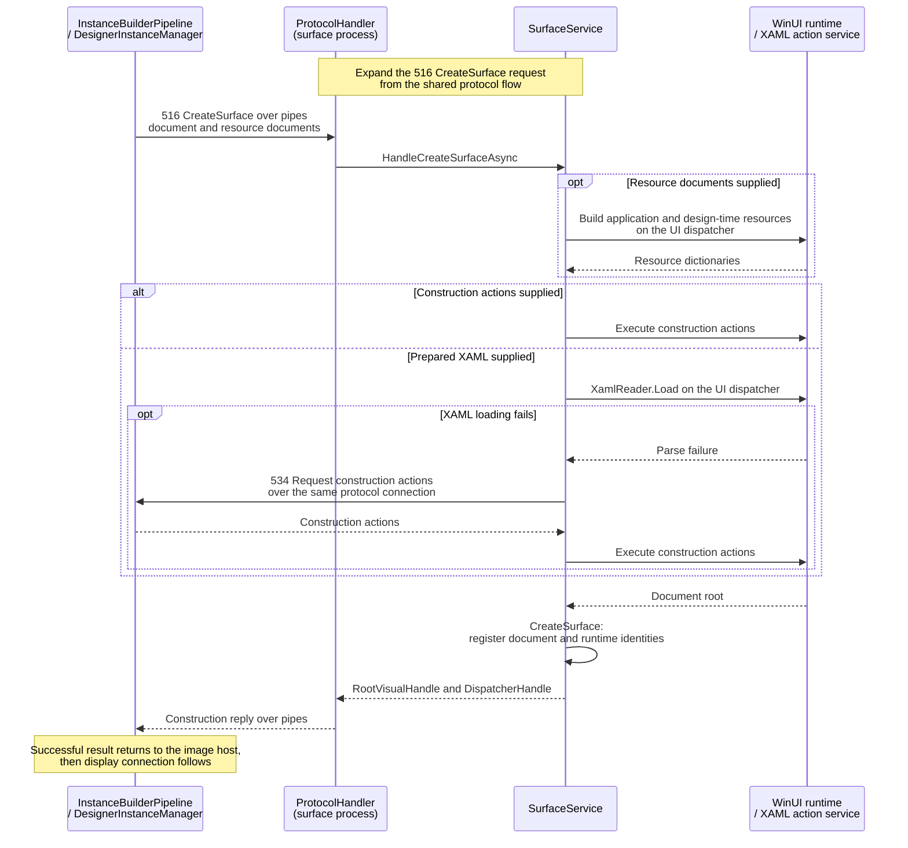
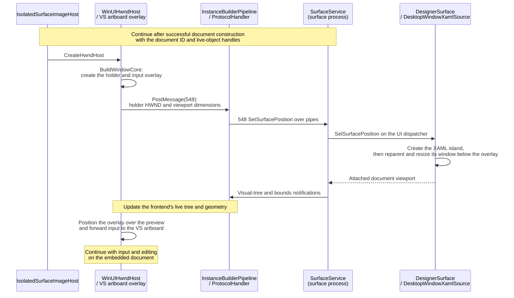
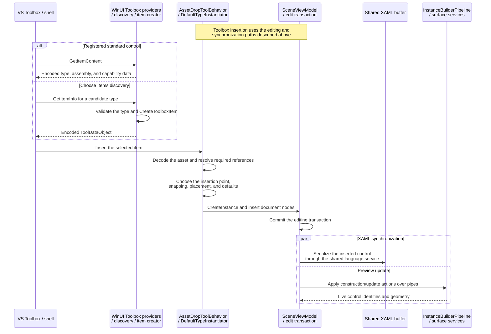
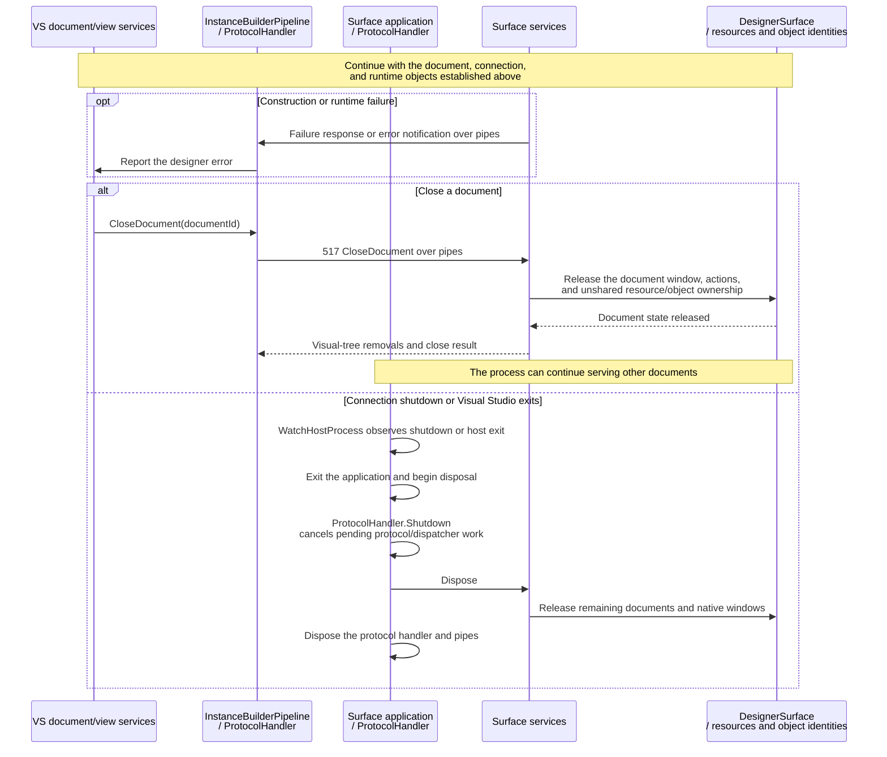

# WinUI designer implementation

This page describes the WinUI extension's implementation bindings, runtime, display adapters, and Toolbox providers. See [Architecture](architecture.md) for the shared designer flow and [UWP XAML Designer](uwp-designer.md) for the built-in UWP implementation.

- [Platform registration](#platform-registration)
- [Starting the isolated process](#starting-the-isolated-process)
- [Communicating with the surface](#communicating-with-the-surface)
- [Loading the XAML document](#loading-the-xaml-document)
- [Embedding the surface](#embedding-the-surface)
- [Handling designer operations](#handling-designer-operations)
- [Synchronizing XAML and design changes](#synchronizing-xaml-and-design-changes)
- [Toolbox integration](#toolbox-integration)
- [Error handling and lifetime management](#error-handling-and-lifetime-management)

> [!NOTE]
> Unless otherwise noted, shortened assembly names such as `DesignerHost.dll` refer to the full file name `Microsoft.VisualStudio.DesignTools.DesignerHost.dll`.

## Platform registration

The extension supplies the implementation bindings omitted by the built-in WinUI configuration. The following configuration examples show the WPF host binding and the desktop WinUI baseline.

For example, the configurations of .NET Framework WPF and WinUI for desktop .NET are registered as follows:

```csharp
RegisterPlatformConfiguration(WpfSpecification, new Dictionary<string, string>
{
    { "PlatformCreatorAssembly", "Microsoft.VisualStudio.DesignTools.WpfSurfaceDesigner" },
    { "PlatformCreatorType", "Microsoft.VisualStudio.DesignTools.WpfSurfaceDesigner.WpfFrameworkPlatformCreator" },
    { "HostPlatformAssembly", "Microsoft.VisualStudio.DesignTools.XamlDesignerHost.dll" },
    { "HostPlatformType", "Microsoft.VisualStudio.DesignTools.WpfDesignerHost.WpfHostPlatform" },
    { "ReferenceAssemblyMode", "TargetFramework" },
    { "PlatformSurfaceIsolatedGuid", "{ABC03A4E-B0A1-41B7-97BA-BB178F354CCD}" },
    { "SupportsToolboxAutoPopulation", "true" },
    { "ToolboxPage", "{7C9BECBA-12B9-4480-9DBF-2345AA3C4F9A}" },
    { "DesignerTechnology", "Microsoft:System.Windows:WPF" },
    { "ClipboardFormat", "CF_WINFX_TOOL" },
    { "ProjectFlavor", "{60dc8134-eba5-43b8-bcc9-bb4bc16c2548}" }
});
```

```c#
RegisterPlatformConfiguration(winuiSpecification, new Dictionary<string, string>
{
    { "DefaultTargetFramework", ".NETCoreApp, Version=5.0" },
    { "SupportsToolboxAutoPopulation", "true" },
    { "SupportsExtensionSdks", "false" },
    { "ToolboxPage", "{8A63BDE2-AEB9-4AF9-A00D-DBC9BD7D509C}" },
    { "DesignerTechnology", "Microsoft:Microsoft.UI.Xaml" },
    { "ClipboardFormat", "CF_WINDOWSUIXAML_TOOL" },
    { "AppPackageType", "WindowsXaml" }
});
```

The built-in WinUI configurations omit both assembly/type pairs. They contain other properties used by designer tools, but do not supply an editing platform or process host. The runtime mapping can still enable a design tab; this project's [platform registration](../src/WinUIDesigner.Vsix/WinUIDesignerPackage.cs) also supplies the missing implementation bindings.

The extension updates the existing desktop WinUI configuration and installs a creator hook that returns its WinUI creator, cached per editing service. This also covers services whose configuration snapshot predates the update. Calls for other XAML runtimes continue through Visual Studio's original implementation. Both the configuration changes and hook follow the extension package's lifetime.

## Starting the isolated process

For this extension, the project architecture selects `WinUISurface.x64.exe` or `WinUISurface.arm64.exe`; the selected executable is staged as `WinUISurface.exe`. Project media and library PRI files are also staged for resource lookup. Startup passes the Visual Studio process ID, diagnostics TAP path, pipe initialization data, DPI context, and Visual Studio installation root. The surface uses that root to resolve private designer contracts from the Visual Studio installation that launched it, initializes the WinUI application and dispatcher, registers its services, and starts receiving messages.

Implementation: [scene-view activation](../src/WinUIDesigner.Vsix/Platform/WinUISceneView.cs), [project context](../src/WinUIDesigner.Vsix/Platform/WinUIProjectContext.cs), [process host and staging](../src/WinUIDesigner.Vsix/DesignerHost), [local process context](../src/WinUIDesigner.Vsix/Platform/WinUISurfaceProcessContext.cs), and [surface startup](../src/WinUIDesigner.Surface/Program.cs).

## Communicating with the surface

The surface uses the existing private protocol types and adds a pipe bridge compatible with the host's initialization data. Its frame reader assembles complete messages even when reads return partial data. WinUI operations are marshalled to the UI dispatcher; the receive thread does not directly mutate XAML objects. Service observers are registered before protocol startup so an early request can be handled.

Implementation: [pipe bridge](../src/WinUIDesigner.Surface/Transport/SurfacePipeDataBridge.cs), [frame reader](../src/WinUIDesigner.Surface/Transport/MessageFrameReader.cs), and [service initialization](../src/WinUIDesigner.Surface/App.xaml.cs).

## Loading the XAML document

The surface first prepares application and design-time resources, then constructs the edited document on its UI thread. When XAML loading fails and actions were not supplied, it asks Visual Studio for construction actions. This alternative also lets the designer build objects individually and associate failures with the editing model.



In this extension, the markup provider prepares App.xaml and design-time resources without using the application's compiled App XBF, following the UWP and WPF providers' preparation flow. The instance manager follows UWP's App.xaml request policy: it sends the document while it is prepared, includes construction actions after an instance-building failure, and uses the UWP provider's eviction signal to choose the normal loading path. Prepared design-time resources follow WPF's state check. The surface retains these shared resource dictionaries across target-document rebuilds; when App.xaml is omitted from a later request, its last theme and resource configuration remains active. When a prepared resource document is sent again, the surface replaces its cached dictionary so edits take effect while keeping application resources before design-time resources. It then loads prepared XAML with WinUI's XAML reader or executes construction actions through its action service. Staged project assemblies, XAML metadata providers, and PRI files supply custom types and resources.

The surface records stable runtime identities and source information, and reports visual-tree changes to Visual Studio. The returned root handle identifies an object; it is separate from the window used to display it. A successful construction reply therefore completes document creation, while embedding happens in the next stage.

Implementation: [document preparation](../src/WinUIDesigner.Vsix/Platform/WinUIDesignerInstanceManager.cs), [construction and tree notifications](../src/WinUIDesigner.Surface/Designer/Surface/SurfaceService.cs), and [project type/resource resolution](../src/WinUIDesigner.Surface/Runtime/ProjectRuntimeResolver.cs).

## Embedding the surface

The extension hosts the document in `DesktopWindowXamlSource` and attaches its window beneath the designer overlay. This diagram expands the WinUI display adapter after document construction.



The WinUI scene adapter replaces UWP's image host while retaining the shared artboard and tools. It sends the holder window and viewport dimensions after the document exists. The surface creates its XAML island, reparents the window, and keeps it below the overlay. The adapter forwards overlay input to the designer's tools.

Viewport size, preview device size, and pan/zoom are separate values. The viewport clips the visible area, device size controls the document's layout, and pan/zoom transforms its content. Keeping these separate allows the overlay, runtime bounds, and hit-test coordinates to agree as the user scrolls or zooms. Layout, bounds, and DPI notifications update the frontend's live view of the surface.

Implementation: [scene and window adapter](../src/WinUIDesigner.Vsix/Platform/WinUISceneView.cs), [overlay placement](../src/WinUIDesigner.Vsix/Platform/WinUIOverlayWindow.cs), and [WinUI island](../src/WinUIDesigner.Surface/Designer/Surface/DesignerSurface.cs).

## Handling designer operations

The surface implements these operation groups:

| Operation | Runtime work |
| --- | --- |
| Property queries | Return live values, base/current values, value sources, and layout information. |
| Hit testing | Find live elements at a point or within a rectangle and return their identities. |
| Snapping | Return container-relative edges, centers, and supported text baselines. |
| Model changes | Create objects, set or clear properties, edit collections and dictionaries, and update names and resource relationships. |
| State and animation preview | Apply visual states and control storyboards on the UI thread. |

Property origins matter to the editing model: a default, local value, or style value can require a different edit. The native diagnostics helper supplies value-source information unavailable through the public WinUI property API. When diagnostics are unavailable, the property service falls back to inspecting local values and explicit style setters. Preview-only dimensions are kept separately from authored dimensions so the preview does not write its device size into XAML.

During a drag, the shared designer updates temporary edits and commits or cancels the final transaction. Its pipeline invalidates cached live values after processing changes and uses runtime geometry to refresh adorners. Rendering can also be suspended while related changes are applied; that suspension is separate from the editing transaction and cache invalidation.

Implementation: [designer operations](../src/WinUIDesigner.Surface/Designer), [object identities](../src/WinUIDesigner.Surface/Designer/Shared/ObjectIdentityRegistry.cs), and [native diagnostics](../src/WinUIDesigner.DiagnosticsTap/DiagnosticsTap.cpp). The action service reports unsupported actions as errors; this implementation does not imply complete parity with every built-in designer operation.

## Synchronizing XAML and design changes

This extension reuses that frontend synchronization. Its responsibility is to preserve the document/object correspondence while applying action batches in order, then report the surviving visual tree and layout. Removing a visual does not immediately invalidate every object handle: an undo operation may reconnect an existing object before the document is closed.

Implementation: [ordered action execution](../src/WinUIDesigner.Surface/Designer/Xaml/XamlActionService.cs), [document ownership](../src/WinUIDesigner.Surface/Designer/Shared/ObjectIdentityRegistry.cs), and [tree/layout publication](../src/WinUIDesigner.Surface/Designer/Surface/SurfaceService.cs). Text parsing and serialization themselves are provided by Visual Studio's `Markup.dll` and XAML language service.

## Toolbox integration

Toolbox integration has three entry points. Static registration supplies standard controls, discovery supplies selectable types from assemblies, and automatic population watches project or package references. The configuration flag enabling automatic population does not itself discover controls.

| Entry point | This extension's implementation |
| --- | --- |
| Standard controls | Register the Common and All XAML control groups from the WinUI registration attribute's item list and provide encoded item content through the package's Toolbox provider. |
| Choose Items | Register WinUI discovery, item creation, and an isolated metadata AppDomain. Accept eligible public, non-abstract controls with a public parameterless constructor. |
| Automatic population | Reuse the available VS infrastructure; complete WinUI project/NuGet discovery is not supplied by the above registrations. |

The inspected VS automatic project source recognizes WPF and UWP base types, but does not list `Microsoft.UI.Xaml.FrameworkElement`. Consequently, the WinUI configuration's automatic-population flag cannot be taken as proof that every project control will appear. The extension supplies standard controls explicitly and a separate WinUI Choose Items discovery path.

The static item list follows the WPF/UWP grouping model: selected everyday controls appear in both the Common and All groups, while the All group contains every registered standard control. Each entry records its qualified type name and Windows platform metadata, and the same item data is used to register both groups.



A Toolbox item describes a type to create; it does not carry an already-created WinUI control into Visual Studio. The extension encodes the shared XAML Toolbox format and adds WinUI capability information. On insertion, the shared tools resolve required references, select a valid destination, and apply placement and default values through the document model. The ordinary text/runtime synchronization then handles the new control.

The preferred Choose Items page identifies the registered discovery provider. It is separate from the static Common and All groups. The metadata AppDomain used for discovery is also separate from the process that renders the document.

Implementation: [Toolbox providers and registration](../src/WinUIDesigner.Vsix/Toolbox) and [package registration](../src/WinUIDesigner.Vsix/WinUIDesignerPackage.cs).

## Error handling and lifetime management

Failures can occur before the surface starts, while the connection initializes, during document construction, or after the preview is displayed. A created tab, running executable, or successful construction reply proves only that particular stage completed.

| Stage | Failure handling in this extension |
| --- | --- |
| Platform and staging | Reject missing private contracts, unsupported project/runtime architectures, missing payloads, and detected WinUI runtime version mismatches. |
| Startup and communication | Log startup exceptions and child-process exits; bound frame sizes and fail incomplete messages. |
| Document construction | Attempt the action-based loading alternative, then return construction failure information and publish error notifications. |
| Runtime operations | Return contract-specific failure results or notifications; dispatcher work observes cancellation and timeouts. |
| Shutdown | Cancel pending protocol work, release document services and native windows, and dispose the connection. |



Closing a document releases its surface and document-owned state. Resources shared with another document are retained until their remaining owners are released. Document closure and process shutdown are separate lifetimes; the connection can serve more than one document.

The surface watches the Visual Studio process and exits when its host disappears or the protocol shuts down. On disposal, it shuts down protocol work before releasing its services and pipes. The extension package also restores the platform configuration entries and removes its creator hook when disposed.
