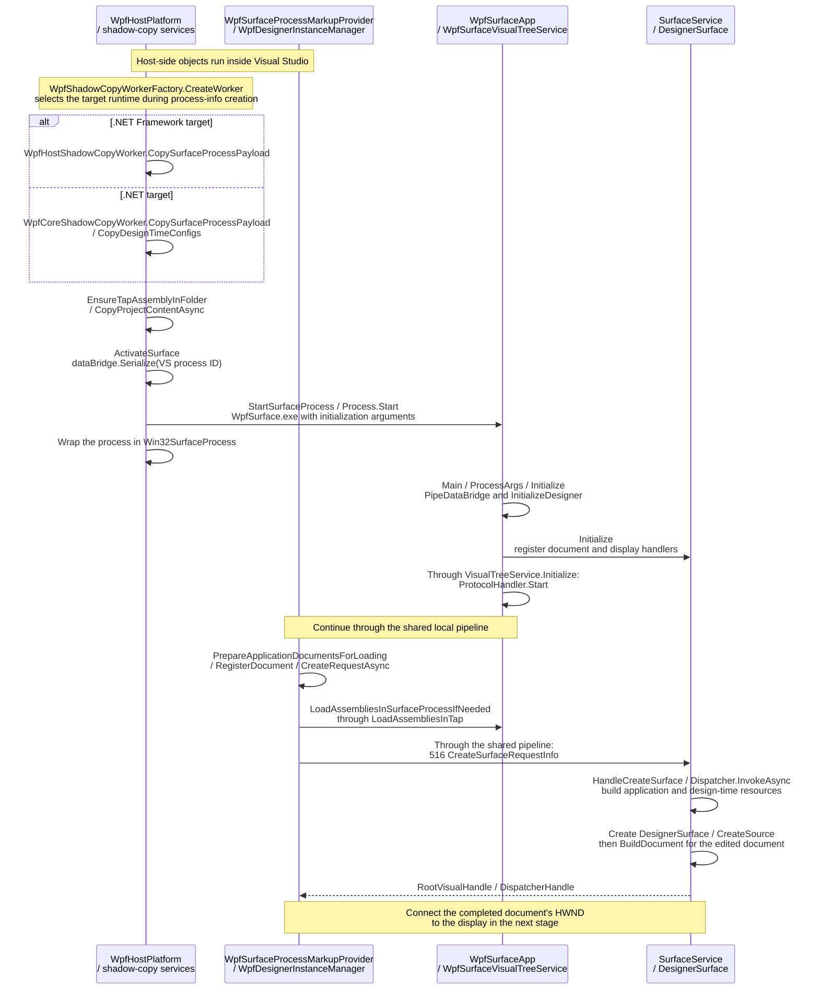
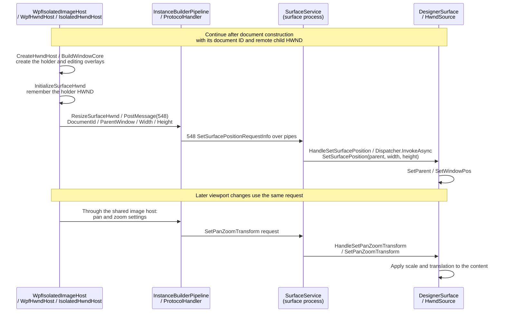
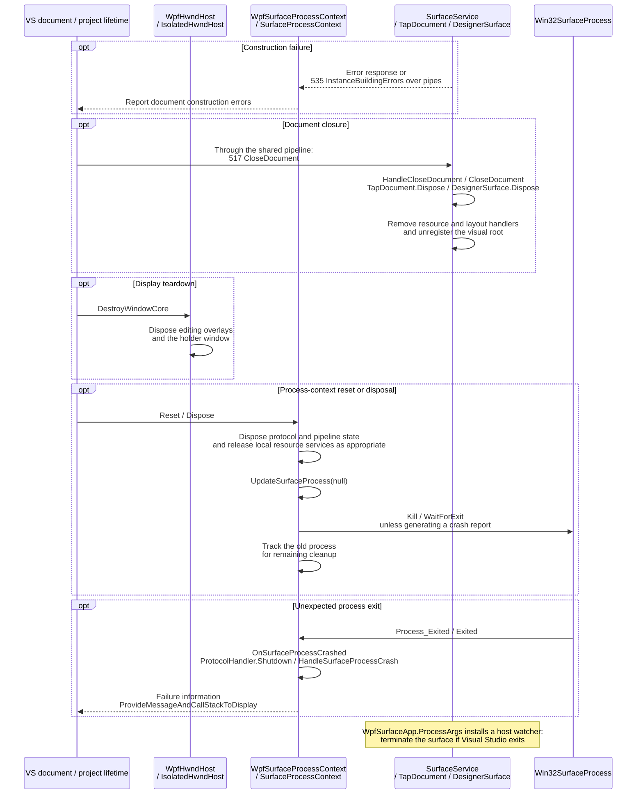

# WPF XAML Designer

This page follows the WPF process and display paths behind the [shared designer flow](architecture.md). The editor, document model, and editing tools run in Visual Studio. A separate desktop process holds and renders the live `System.Windows` objects.

- [Starting the application and creating a document](#starting-the-application-and-creating-a-document)
- [Embedding the surface](#embedding-the-surface)
- [Error handling and lifetime management](#error-handling-and-lifetime-management)

> [!NOTE]
> Unless otherwise noted, shortened assembly names such as `DesignerHost.dll` refer to the full file name `Microsoft.VisualStudio.DesignTools.DesignerHost.dll`.

## Starting the application and creating a document

When a live preview is needed, the host selects a surface runtime and copying strategy for the project's target framework and architecture. It stages the desktop surface and project content in a shadow cache, then starts the surface executable with the Visual Studio process ID, diagnostics location, pipe initialization data, and DPI context.

The .NET Framework path stages its framework surface. The .NET path also prepares runtime configuration and dependency files so the surface uses the project's runtime and dependencies. The selected diagnostics files are made available before startup.

The surface initializes WPF design mode, diagnostics, and its UI dispatcher, then connects the TAP services to the shared protocol. Visual Studio prepares application resources, design-time resources, and the edited document, loading required assemblies into the surface before sending the construction request.

The request identifies documents and their prepared content. Each edited document receives a designer surface with its own child window. The returned root-object handle connects the editing model to live content; the display window is attached in the next stage.

Document construction can use staged XAML or construction actions. If actions are needed but unavailable, the surface requests them through the existing connection. Application resources and design-time resources are prepared before the edited document is built. The shared communication and editing pipeline is described in the [main document](architecture.md#communicating-with-the-surface).

## Embedding the surface

After document construction, Visual Studio creates a holder window and the transparent layers used by its editing tools. The WPF image host associates that holder with the document's remote surface and sends its parent window and viewport dimensions over the protocol connection.

The surface applies the request on its UI dispatcher, attaches its WPF child window beneath the holder, and sizes it to the viewport. Rendering remains in the surface process, while selection adorners and editing tools remain in Visual Studio.

Viewport dimensions determine the visible window area. Pan and zoom transform the content within it rather than replacing the document's authored layout dimensions. Live geometry and layout notifications let the shared editor keep its tools aligned with the rendered content.

This display path attaches a remote child HWND. The [UWP display path](uwp-designer.md#embedding-the-surface) instead opens a shared composition visual and connects it to a local DirectComposition target. Both retain local windows and editing overlays.

## Error handling and lifetime management

WPF-specific failures can occur while locating the target framework, preparing runtime configuration and dependencies, starting the executable, loading project types, constructing a document, or attaching its window. Missing .NET runtime components can be reported from the process exit status; construction errors return through the document protocol.

Document closure, display teardown, and process reset have separate lifetimes. Closing a document releases its runtime surface state. Closing the display releases the local holder and editing overlays. Resetting or disposing the process context releases the connection and ends the associated desktop process.

Releasing the process wrapper's operating-system handle is separate from terminating the process. The process context requests termination and waits during replacement or shutdown, while later cleanup handles any remaining process references.

A parented surface window and its local holder also have separate ownership. Runtime disposal removes the document's resource and visual-tree connections; it does not unconditionally dispose a parented window source. The shared display teardown handles its holder and overlays.

The surface watches the Visual Studio process and terminates itself if the host exits. Document closure alone does not imply process shutdown; other documents can continue using the same process according to the shared lifetime rules.
