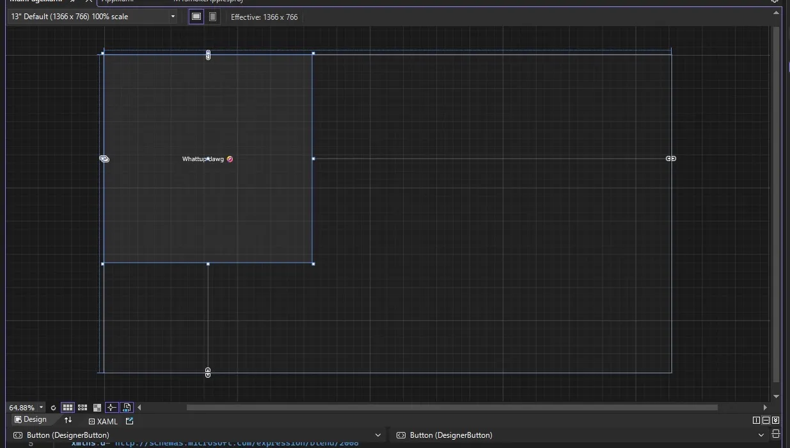

# Overview

Having trouble? Please [report a bug on GitHub](https://github.com/0x5bfa/WinUIDesigner/issues/new?template=bug_report.yml).

## Limitations

- Only C# WinUI projects are supported.
- x86 is not supported.
- `Window` and its subclasses cannot be previewed; only `FrameworkElement` subclasses are supported.
- Windows App SDK 2.5.1 is required.
- In a multi-targeted project (for example an Uno Platform project), the Windows target (`net*-windows10.0.*`) must be the active target framework of the project that contains the XAML file. Uno.Sdk projects select the Windows App SDK version with the `WinAppSdkVersion` property.

## Architecture

See [Architecture](https://github.com/0x5bfa/WinUIDesigner/blob/main/docs/architecture.md) for the designer's processing flow and implementation details.
